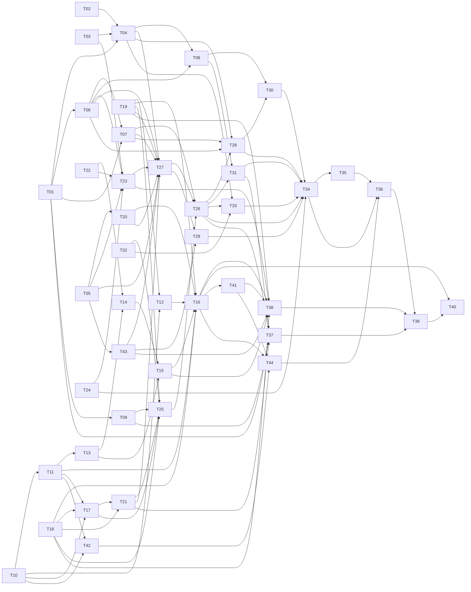

# Plan and Tasks — #276 run and coordinate stage agents through CLI and Runtime skills

Current scope: [maintainer addendum](#implementation-scope-addendum--2026-10-15). Technical baseline: [2026-10-15 reconciliation addendum](#reconciliation-addendum--2026-10-15), including the v3 configuration overlay and current delivery governance. Historical status statements below retain their dated meaning.

## Implementation scope addendum — 2026-10-15

Authority: maintainer comment `e67f6bbe-74dc-408d-b02d-bda86f930ca7`
([AXM-8](https://linear.app/rgomids/issue/AXM-8/mvp-run-and-coordinate-stage-agents-through-cli-and-runtime-skills)),
read in full before implementation. The maintainer explicitly authorizes a
bounded T16/T14 implementation and publication of this scope summary.

- All real Runtime tests, version/help commands, authentication, inference,
  probes, installed smoke and Provider effects are deferred: **NOT_RUN**.
  The maintainer assumes the risk of postponing this proof. Synthetic unit,
  integration, fake subprocess, security and CI checks remain required;
  authority gates, binding checks and fail-closed refusal remain mandatory.
- T40 is optional and non-blocking for **technical delivery**. Its own Done
  criterion and AC-6 still require real, independently authorized Evidence;
  NOT_RUN, FAILED or INCONCLUSIVE do not satisfy them. A future attempt needs
  its exact envelope, independent consent and all prerequisites. The owner
  performs real validation and final acceptance after technical delivery.
- Active T43 platform scope and expected Evidence are **Linux and macOS**:
  POSIX descendant containment and confirmed stop, with synthetic tests and
  applicable native CI. Windows job objects, native Windows Evidence and
  Windows CI are excluded, reusing [Specification 006](../006-installer-host-eligibility/spec.md).
  The same platform scope applies to T13 envelope checks. Historical Windows
  wording in the accepted Plan/catalog is preserved, with this explicit scope
  disposition; it is no longer an active delivery requirement.

This addendum qualifies the earlier T40/T43 gate assessment and historical
platform requirements without changing accepted ADRs, Task numbering, DAG,
corpora, hashes or receipts. It grants no merge, release, operational acceptance
or automatic AXM-8 state transition. No capability is proven by this decision.

## Status

**Part I (Plan), revision 5 — Accepted, 2026-10-11**, by
[explicit maintainer acceptance](https://github.com/rgomids/axiom/pull/311#issuecomment-6109867861) at HEAD
`4b8c888c66be3a30a2757761f71a4f9df2703631`, blob
`13776ae4e5923b2c30439b2b12586b202d864c11`, together with PD-1–PD-17 as
recommended. **Part II (Tasks) — Proposed, awaiting human approval.** Only the
Status section of Part I changed after acceptance (administrative
reconciliation); the accepted bytes remain addressable by that blob.

The acceptance authorizes preparing Tasks only. It does not authorize
implementation, Runtime dispatch, real inference, Provider effects, merge,
release or human acceptance of #276.

## Administrative post-merge reconciliation — 2026-10-12

This later observation supersedes operational dependency status in the historical
Plan, not its accepted technical contract or approval receipt. PR #310 merged at
2026-10-12 03:05:33 UTC (00:05:33 America/Sao_Paulo), commit
`5e1c995ab57ed3fbd54e5b72288607140d031e7d`, already included in PR #311 HEAD
`3c2f436823740ce97c5616c0cb3106b9fea4dbe0`.
All 23 #306 Tasks were [accepted](https://github.com/rgomids/axiom/pull/310#issuecomment-6109821395);
its complete technical delivery was [accepted at dd6fc596](https://github.com/rgomids/axiom/pull/310#issuecomment-6117000624).
The integrated [implementation Evidence](../002-lingo-project-initialization/evidence-306-implementation.md)
records local, synthetic and native boundaries; its older pending-merge wording is historical.
Workflow2, StagePlan2, Execution3, Graph2, Profile-owned effort, effort-source
inspection, default-sdd r2 and Runtime/Profile authoring are available to consume.
Real capability/model/effort proof, #276 dispatch and operational acceptance remain pending.

| Gate | Current technical state | Remaining #276 gate |
| --- | --- | --- |
| IG-1 | Supported authoring/onboarding delivered and integrated | Clean supported configuration and separately authorized operational proof still required for T40 |
| IG-5 | Accepted effort/version contract implemented and integrated | Consume frozen tuple and source checks; no Workflow effort override or proof inferred from declaration |
| IG-6 | axiom-runtime skill delivered and integrated | #276 capability routes and tests remain proposed; installed-state operation not proved here |
| IG-7 | X01–X07 technical delivery integrated; #306 producer prerequisite satisfied | #306 side satisfied. Remaining #276 gates: acceptance of proposed ADR-0026 and successor amendment, T01 successor codec, #276 admission/integration verification (T09/T37) and separately authorized real proof |

CR-013 operational status is reconciled by this note. CR-012 decision
**PD-R276-01** ([Decision Packet and Evidence](reconciliation-276-post-merge-306.md))
was answered with direction **B** (see next section); the detailed contracts and
reconciled Tasks remain Proposed.
Statements below about #306 saying “Tasks Proposed”, “not implemented”,
“not yet merged” or “IG-7 unsatisfied because #306 is undelivered” describe the
accepted historical baseline only. #276 Tasks remain Proposed today. They cannot assign new work to completed I306-X05.
Phase 1 remains Accepted; Phase 2 remains Proposed / Awaiting Human Approval;
Phase 3 is Not Authorized; PR #311 remains Draft.

| Item | Value |
|---|---|
| Work Item | [#276](https://github.com/rgomids/axiom/issues/276) / Linear AXM-8 (operational status lives in Linear) |
| Parent | [Epic #15](https://github.com/rgomids/axiom/issues/15); Spec 007 requirement **WF-009**, acceptance **AC-009** ([spec.md:62](spec.md), [spec.md:547](spec.md)) |
| Contract consumed | [Spec 007](spec.md) (Accepted 2026-10-09), [amendment #303](amendment-303-workflow-skill.md) + [ADR-0022](../../decisions/0022-dedicated-workflow-conversational-surface.md) (Accepted 2026-10-10), [ADR-0003](../../decisions/0003-lingo-as-axiom-local-control-plane.md), [ADR-0004](../../decisions/0004-portable-project-manifest.md), [ADR-0005](../../decisions/0005-bounded-local-filesystem-threat-model.md), [ADR-0007](../../decisions/0007-local-publication-and-recovery-protocol.md), [ADR-0008](../../decisions/0008-minimal-machine-local-execution-record.md), [ADR-0009](../../decisions/0009-parent-child-execution-graph.md), [ADR-0020](../../decisions/0020-workflow-definition-revision-binding.md) |
| Contracts from this PR | [Spec 007 amendment #276](amendment-276-stage-dispatch.md) and [ADR-0025](../../decisions/0025-public-stage-dispatch-and-capability-proof.md): **Accepted 2026-10-11** (blobs `3c931f0`, `1da38d6`) |
| Maintainer decisions incorporated | **D-1 resolved** ([PR #311 comment](https://github.com/rgomids/axiom/pull/311#issuecomment-6108112930)): capability proof for stage execution is a #276 deliverable. **#306 contracts consumed as accepted on PR #310** ([acceptance](https://github.com/rgomids/axiom/pull/310#issuecomment-6109183466), commit `823bce3`; not yet merged): vendor-managed authentication (D2), Profile-owned effort and versioned migration (amendment-306 PE-01–PE-06, ADR-0024) |
| Satisfied predecessors | #274 (binding), #275 (stage compiler, v0.15.0), #303 (skill surface, v0.16.0), #272 (auth preflight), #230 (resource lifecycle), #271 (contracts) — implementation baseline only |
| Parallel work | [#306](https://github.com/rgomids/axiom/issues/306) / [PR #310](https://github.com/rgomids/axiom/pull/310), head `c4cb5aa` (local Runtime/Profile authoring, Profile-owned effort, `axiom-runtime` skill, Accepted ADR-0023/ADR-0024; PD-OWN [decided on PR #310](https://github.com/rgomids/axiom/pull/310#issuecomment-6109651213): I306-T01–T16 and I306-X01–X07 all belong to #306 / PR #310; those Tasks are still Proposed and the migration is not implemented) — boundary in §3.10 and §10 |
| Successors (not in scope) | #277 delivery/rework, #278 / AXM-12 R-2 native and R-3 human MVP acceptance |
| Code baseline | `main` `5d52327` (v0.16.0); Plan revision 1 at `0f5ba21` |
| Lifecycle | One branch (`feat/276-stage-agent-execution`) and one Draft PR (#311) for Plan → Tasks → Implementation, each separately approved |
| Review | Revision 1: independent adversarial review. Revision 2: maintainer REQUEST CHANGES (D-1, CR-001, ADR collision, metadata). Revision 3: [Code Review Guardian re-review](https://github.com/rgomids/axiom/pull/311#pullrequestreview-5483400200) findings CR-004–CR-006 (§12.5) |

Observed statements cite `file:line` on the baseline. Statements marked
*(inferred)* must be confirmed in the named Task. **PD-n** items need explicit
human approval (§12). **IG-n** items are integration gates owned outside
#276 (§10). Vendor interface facts come only from local `--version`/`--help`
output of the installed CLIs (Codex CLI `0.159.1`, Claude Code `2.1.296`,
observed 2026-10-11, no inference, no authentication) and must be
re-observed at implementation time.

---

## Approved architectural direction / proposed contract revision — 2026-10-12

[Maintainer receipt](https://github.com/rgomids/axiom/pull/311#issuecomment-6125676685) accepts **PD-R276-01/B as direction only**:
use an explicitly versioned successor Graph owned by #276, while preserving
delivered Graph1/2 and the completed #306 scope. The proposed
[ADR-0026](../../decisions/0026-successor-stage-dispatch-graph-format.md)
and [successor Spec amendment](amendment-276-successor-graph-proposed.md)
still require separate exact-artifact acceptance. Under ADR-0018 the accepted
Part I §3.5/§3.10/PD-16 and ADR-0025 remain historical; no supersession of
their joint-Graph2 fragment is effective until the new ADR is accepted.
The **reconciled Part II Tasks are Proposed**, not approved for implementation.
No code, codec, Runtime dispatch, inference or real smoke is authorized.

## Maintainer acceptance and delivery governance — recorded 2026-10-13

This later administrative record supersedes the Proposed status statements
above and in Part II, not their technical content. The maintainer (Rafael)
accepted, as recorded in `main` at `bf3c6218422123fb99b6a30ef89f92f5bc7d5e7d`:

- [ADR-0026](../../decisions/0026-successor-stage-dispatch-graph-format.md)
  (blob `1a99a571ee74656a23fa294dfae7e3bc63bc2469`);
- the [successor Spec amendment](amendment-276-successor-graph-proposed.md)
  (blob `53ac761f31e79dbff1c6ed9652de92f8556e7a6f`);
- all 44 Part II Tasks, `I276-T01`–`I276-T44`, exactly as defined in this file
  at that commit (blob `3a78512ffe596957957deaabb76d2137a126de11`);
- implementation within those accepted contracts.

The acceptance was communicated through the AXM-21 work brief; no separate
public receipt (comment URL, signature or reviewer record) was supplied, so
none is cited. Task wording, dependencies, acceptance criteria and authority
gates are unchanged. Real probes, inference, T40 smoke, Provider effects,
merge and release keep their own separate authority gates.

| Layer | State |
|---|---|
| Accepted plan | Part I (2026-10-11), ADR-0026, successor amendment and the 44 Tasks |
| Authorized implementation | Within the accepted contracts, delivered one child Work Item at a time |
| Implemented code | Only what a merged child PR and its Evidence record name; acceptance marks no Task implemented |
| Verified Evidence | Per-Task Evidence files; synthetic Evidence is never operational proof |
| Operational acceptance | Pending (#276 acceptance criteria, T40 and human acceptance) |

**Delivery governance.** AXM-8 / #276 remains **In Progress**. PR #311 merged
as the original delivery slice (squash `ee3bbaa`). Further implementation is
split into approved child Work Items owned by AXM-8: exactly one branch and one
PR per child card, each branched from current `main`. A child PR merge does not
complete AXM-8; the original #276 acceptance criteria still apply and final
reconciliation happens at the parent card. This supersedes the single-branch
lifecycle row above for future delivery only. AXM-21 owns Capability Evidence
Selection under I276-T16/T17 ([implementation record](issue-276-implementation.md#axm-21--capability-evidence-selection)).

**Evidence selection policy (AXM-21).** A unique, exact, fresh, valid and
non-invalidated Evidence matching the complete independently observed
Binding/ModelBinding is selectable. Missing Evidence fails closed; several
matching records fail closed as ambiguous. No automatic precedence (newest,
oldest, name or digest order) is accepted; a multiple-Evidence policy remains
a pending decision. The production BindingSource and T34 composition remain
separate work; T16/T17 are not complete.

## Reconciliation addendum — 2026-10-15

This dated operational addendum takes precedence over stale status, delivery
strategy and configuration-version references below. It does not edit Part I
revision 5, the accepted Task catalog, approval receipts or historical digests.
The [current Task/Evidence matrix](issue-276-implementation.md#reconcile-2026-10-15--main-baseline-and-task-matrix)
records the observed `main` SHA, integrated code, validation and remaining gates.

- **Acceptance:** the 2026-10-13 record above remains effective: ADR-0026,
  successor amendment and T01–T44 accepted; implementation within those
  contracts authorized. Older “Proposed”, “Not Authorized”, “#311 Draft” and
  “none executed” wording is dated history, including Part II tables, batches,
  traceability and review readiness. Acceptance is not Task completion,
  operational proof, inference/probe consent, merge or release authority.
- **Configuration delta (§3.10; T09/T21/T25/T26/T37):** apply the later
  [AXM-22 PM / PM-8 / PM-11 contract](amendment-276-axm22-binding-identity.md#pm--pre-mvp-canonical-configuration-format-bld-001b3c).
  Active canonical Runtime/Profile **format 3 only** is admitted. Local v1/v2
  are pre-stable history, not operational fallbacks; no v2→v3 migration,
  automatic conversion or downgrade. Explicit authorized retirement then fresh
  v3 authoring replaces migration. A recognized valid pre-stable record may
  pass the *application upgrade* gate with bytes preserved and reconfiguration
  guidance; this does not admit Runtime/Profile execution. Malformed, unsafe,
  future and recovery states retain their refusals.
- **Matrix overlay:** §3.10 historical rows 8–10 and any other local-v2
  positive dispatch row are not current admission recipes. Replace the current
  configuration premise with active v3 and apply the unchanged frozen tuple,
  effort inspection, capability, auth and authority checks. Preserve the old
  rows as historical verification, adding v3 admission/refusal verification;
  do not relabel historical fixtures as current v3 proof. The I306-T02
  cross-PR producer row is a delivered historical contract, consumed through
  the subsequent AXM-22 v3 activation. #306 is not reopened.
- **Independent formats:** Workflow schema 2, Stage Plan v2, Execution format 3
  and successor Graph3 are separate contracts. Runtime/Profile v3 does not
  imply a new Workflow/Execution/Graph version. ADR-0026 governs the successor;
  Graph1/2 bytes/readers/corpus remain immutable, readable under their original
  semantics and refused for #276 mutation. Historical Profile-v2 wording in
  the accepted ADR/successor amendment is interpreted through this later
  configuration overlay; their accepted text and hashes are preserved.
- **Delivery governance:** the founder's 2026-10-14 reconsolidation in
  [AXM-8](https://linear.app/rgomids/issue/AXM-8), confirmed by the 14/10
  reconciliation decision (comment `df8bc25f-d795-4823-8e8f-0e7f62b766c7`),
  supersedes both the original single-PR-forever row and the 13/10 future-child
  strategy. Remaining work stays in AXM-8/#276; at most **one open work PR**
  for AXM-8, reused if present. Historical merged #311/#315/#318 remain closed
  history. AXM-21/22 keep their Evidence; AXM-23–26 are canceled, with scope
  returned to AXM-8. No replacement cards or lifecycle/relationship mutations.
- **Stable IDs:** T34 = Stage and coordination CLI; T44 = Capability CLI.
  Linear's ex-AXM-23 “T34 composition/publication/retry digest” is a later
  implementation-gap alias within T25/T26/T31/T34; ex-AXM-24 “T44 stage
  dispatch CLI” maps to approved T34, not a renumbering of T44. Ex-AXM-25
  maps to T06/T07/T08/T31 fencing/recovery; ex-AXM-26 to T36–T40 verification
  and acceptance preparation. Their names create no new Task or acceptance.
- **T41 optionality:** optional means *execution* of the extended temp-root
  probe, separately previewed and authorized. Delivery of its guarded use case,
  refusal/residue tests (T38) and CLI (T44) is in the approved catalog.
  T41→T38/T44 edges therefore stay; a standard probe or T40 need not execute
  the extended probe. Skipping its implementation would require a material
  scope decision; no such waiver is inferred here.
- **DAG/batches:** retain the approved IDs, edges and batch membership. Batches
  group review/integration work, not strict barriers: e.g. B0 T14 needs B0
  T22; B2 T16 needs B0 T20; B3 T27 needs B1 T07/B0 T43. The current matrix
  names residual dependencies; old batch headings do not describe execution
  status or require repeating integrated foundations.

# Part I — Plan

## 1. Scope and objective

### 1.1 Problem

Axiom already contains a tested parent/child Execution Graph, scheduler,
workspace isolation, integration, nine typed coordination record kinds and
their stores. None of it is reachable from the installed product: the only
caller of `internal/graphapplication` is the checkout-built, `//go:build
ignore` acceptance runner
([s9-graph-runner.go:1-6](../../../scripts/acceptance/s9-graph-runner.go)),
and `workflow stage plan` says its proposal is "not dispatchable in this
release (#276)" ([workflow_stage_plan.go:112](../../../cmd/lingo/workflow_stage_plan.go)).
In addition, the production observer proves only `axiom-skills`
([observation.go:17-21,107-128](../../../internal/runtimeadapter/observation.go)),
so even a wired dispatch path would refuse every real stage that needs
`read`, `repository-write` or `process`
([issue-275-implementation.md:303-309](issue-275-implementation.md)).

### 1.2 Expected user-visible behavior

From the installed `axiom` CLI, or from the `axiom-work-item` skill in either
Codex (`$axiom-work-item`) or Claude (`/axiom-work-item`), a developer whose
Work Item Execution is bound to an immutable workflow revision can:

1. establish, with explicit authorization, bounded proof that each installed
   and configured Runtime binding can actually read, edit and run commands in
   an authorized worktree non-interactively, and see what is `proven`,
   `unsupported` or `unknown`;
2. preview dispatch of a planned stage and review, per child: Runtime,
   Profile, model and Profile-owned effort, required capabilities and their
   proof, **authorized effects**, the **enforced confinement** (OS-enforced
   or advisory) and validators;
3. confirm it once; the confirmation is persisted with the graph before any
   process starts and covers only the first attempt of each child;
4. let Axiom dispatch ready Codex and/or Claude children concurrently only
   where allowed, without the initiating Runtime session staying alive;
5. observe parent/child progress, blockers, coordination and dependencies
   from either Runtime or the CLI, including after the initiating session ends;
6. cancel, reconcile uncertain attempts, retry explicitly and request the
   separately authorized integration step;
7. receive truthful `denied_authority`, `validation_failure`, `interrupted`,
   `failure/recovery_required` and `partial` outcomes.

Agentic capability is not machine-wide authority: children write only in
their approved worktree and their own coordination inbox, run commands only
within the approved envelope, and never push, open PRs, merge, publish or call
Providers.

### 1.3 Included capabilities

- Public application service composing graph, scheduler, workspace,
  integration, coordination and Runtime-policy services for one Work
  Item-bound Execution stage, graph or single-agent.
- **Capability observation and proof (IG-4 / amendment G-3, D-1)** for the
  capabilities stage execution needs, bound to Runtime, executable identity,
  version, invocation mode and, where applicable, model and effort (§3.9).
- CLI operations under `axiom workflow` (Execution family) and `axiom
  runtime <id> capability` (§5), with thin skill routes.
- Child coordination publish/read with lineage, revision, scope, provenance
  and capacity enforcement; **durable coordination-to-graph classification**
  (CR-001, §3.5).
- Durable dispatch authority for graph and single-agent paths (G-5).
- Cancellation per Spec 007, interruption, stale/orphan detection,
  append-only reconciliation, explicit retry.
- Help/result metadata, docs, deterministic tests and a bounded real
  two-Runtime smoke procedure executed only under separate authorization.

### 1.4 Non-goals

UI/dashboard; long-lived daemon, broker, HTTP/MCP server or new control
plane; general distributed workflow engine; API-billing prerequisite;
automatic fallback, merge, push, PR or release (#277); local Runtime/Profile
authoring, onboarding templates, Profile-owned effort storage and the
`axiom-runtime` skill (#306 / PR #310); credential capture or management;
Project policy editing (#305); new global Doctor (#231); #241 hardening;
R-2/R-3 acceptance (#278). Capability proof covers only what stage execution
requires (§3.9), not a general vendor capability catalog.

### 1.5 Relationship to the MVP journey

Spec 007 order is `#273 → (#274, #275) → #276 → #277 → #278`
([spec.md:561-562](spec.md)); #306 joins as the local-configuration
prerequisite. #276 turns a bound Execution and a stage proposal into
proven-capable, authorized, executed, coordinated and integrated stage
outcomes. It produces deterministic/synthetic Evidence plus one early real
engineering smoke; R-2/R-3 remain with #278.

## 2. Current-state assessment (observed)

### 2.1 Reusable components

| Area | Component | Evidence |
|---|---|---|
| Binding | `workflow start` creates an Execution with immutable `WorkflowBinding`; `workflow status/resume` | [execution_target.go:54-112](../../../cmd/lingo/execution_target.go), `internal/workflow/service.go:281,460` |
| Stage compilation | `workflowcompiler.Compile` → `graph` proposal or `single`; `PlanStage` → `StagePlan`; requested effort currently taken from `agent.Effort` | `internal/workflowcompiler/compiler.go:145,186`, `stage_plan.go:27-137` |
| Public plan op | `workflow stage plan` (read-only, digest-bound) | [workflow_stage_plan.go:43-112](../../../cmd/lingo/workflow_stage_plan.go) |
| Graph model | Parent/children, envelopes, attempts; statuses not-started/running/blocked/succeeded/failed/cancelled/skipped/unknown; `Attempt{Status, ExitCode, ResultReference, AmbiguousEffect, CancellationSeen}`; `AuthorityReferences map[string]string` | `internal/executiongraph/graph.go:29-100` |
| Graph publication | `GraphService.Publish(PublicationRequest)` with create + reload + digest compare | `internal/executiongraph/graph.go:126-209` |
| Planner rules | DAG, one integration+validation owner, unsafe overlap, authority subset, limits | `internal/executiongraph/planner.go:17-23,73-93,117-170` |
| Scheduler | Ready set from last-attempt status; non-conflicting batch; attempt persisted `running` before spawn; terminal save after `wg.Wait`; explicit retries; `CancelRequested` | `internal/executiongraph/scheduler.go:94-262` |
| Integration | Digest-bound preview/execute, single persisted attempt | `internal/executiongraph/integration.go:215,280,332` |
| Composition | `graphapplication.LocalService` + per-dispatch policy guard (preview, executable digest, credential reference, subscription auth) | `internal/graphapplication/local.go:49-150`, `runtime_policy.go:87-161` |
| Adapters | Codex `exec --model`, Claude `--print --model`; effort only when capability-proven | `internal/runtimeadapter/adapters.go:92-150` |
| Observation contract | `Observation{Installed, Available, Version, ExecutableDigest, CapabilityStatus, NonInteractiveModelCapabilities}`; `supports` requires Profile declaration **and** `CapabilityProven`; effort additionally requires per-model proof and a known version | `internal/runtimeprofile/runtimeprofile.go:37-38,70-86,297-313` |
| Auth preflight | Per-invocation subscription preflight; `credential_reference_configured` refusal | `internal/runtimeadapter/authpreflight.go:162`; `runtime_policy.go:117` |
| Coordination | Nine kinds, hash-chained per-child streams, filters, 64 records/stream, 64 KiB/record | `internal/coordination/coordination.go:42-52,78,115,209,301-347` |
| Stores | `local.GraphStore` (CAS), `local.CoordinationStore` (lock, chain re-check) | `internal/local/graph_store.go`, `internal/local/coordination_store.go:97` |
| Skills | One embedded set for Codex and Claude; `axiom-work-item` owns run/status/plan | `internal/codexruntime/runtime.go:15`; ADR-0022:58-67 |

### 2.2 Gaps for #276

| # | Gap | Evidence | Disposition |
|---|---|---|---|
| G1 | No production `StagePlan` → `GraphService.Publish` path | `stage_plan.go:94-109`; `s9-graph-runner.go:309-323` | Extend |
| G2 | `LocalService` not wired; in-memory graph; no load/resume | `local.go:49-150` | Extend |
| G3 | No public stage/coordination/capability operations | `internal/cli/commands.go:26-83` | New |
| G4 | No stdin on `Invocation`/`OSProcessRunner`; prompt appended to argv by runner | `scheduler.go:22-31,361-366`; `s9-graph-runner.go:249` | Extend |
| G5 | Argument guard is a denylist of selection options; does not reject permission/sandbox bypass options | `runtime_policy.go:207-232` | Replace by allowlist (§3.6) |
| G6 | No production `CommandProfile` source; no `CredentialResolver` | `cmd/lingo/runtime_policy.go:87-104`; `adapters.go:56-75` | Derive (§3.6) |
| G7 | Coordination store: only `Latest`/`Publish`; empty `AttemptID` accepted | `coordination.go:115,301-307` | Extend |
| G8 | **Defect:** `readyChildren` redispatches a child whose last attempt is `running` when retry is authorized | `scheduler.go:237-255` | Fix + regression |
| G9 | No stale/orphan detection, reconciliation or process-group control | `scheduler.go:361-381` | New |
| G10 | Timeouts yield `unknown` (`Stopped: false`) | `scheduler.go:378-381` | Keep truthful |
| G11 | Validators resolve only `builtin-sdd-v1`; repository commands need separate authority | `workflow_references.go:93-116`; [spec.md:176-180](spec.md) | PD-7 |
| G12 | Plan approval not durable (G-5) | amendment:323 | PD-3 |
| G13 | Subscription auth opt-in | #272 record:124-127 | PD-5 |
| G14 | Children inherit full `os.Environ()` | `scheduler.go:336-357` | Allowlist (§3.6) |
| G15 | No help/result metadata or skill routes | `skill_inspect.go:60-215` | New |
| G16 | Concurrency only compile-time | `compiler.go:397` | Defensive check |
| G17 | **Capability proof missing:** observer proves only `axiom-skills`; version always unknown; no proof for `read`, `repository-write`, `process` or per-model effort | `observation.go:83-128`; `docs/commands.md:603-610` | **#276 deliverable (§3.9, D-1)** |
| G18 | Coordination outcomes have no durable effect on graph state: scheduler readiness and integration read only attempt status/exit code | `scheduler.go:210-262`; `integration.go:332` | **CR-001 (§3.5)** |
| G19 | Effort is a Workflow agent field (`agent.Effort` → `RequestedEffort`), contradicting the #306 D3 direction (effort owned by local Model Profile) | `compiler.go:186`; `stage_plan.go:134-137`; `workflowdefinition/definition.go:102-117` | Consume #310 amendment (IG-5, §3.10) |

## 3. Proposed architecture

### 3.1 Containers and boundaries (C4 level 2, delta only)

The container view in `docs/architecture/` is unchanged: one local `axiom`
binary over machine-local state. #276 adds one application component
(`stageexecution`, name provisional), one capability-proof component, a
bounded supervisor mode of the same binary, and CLI/skill entrypoints.

```text
 Codex/Claude session (skills) ─┐   Terminal ─┐        (operator surfaces only)
                                ▼             ▼
        internal/cli  (parse, help, render; no domain rules)
                                ▼
 cmd/lingo composition ─► stageexecution.Service   ─┬─ workflow.Service (binding, gates, ledger)
                                                    ├─ workflowcompiler (recompile, digest compare)
                                                    ├─ runtimeapplication (Project ∩ local Profile ∩ observation)
                                                    │      └─ capability observer ◄── capabilityproof (NEW)
                                                    ├─ executiongraph (Publish, Scheduler, Integration, classifier)
                                                    ├─ graphapplication (LocalService, guard)
                                                    ├─ coordination (validate, chain, stream read)
                                                    └─ runtimeadapter (argv allowlist, confinement, env, packet, auth)
                                ▼
 internal/local stores: workflow, graph (+classification, reconciliation), coordination,
                        capability evidence (NEW), runtime profile (read-only here; authored by #306)
                                ▲
 axiom stage supervisor (same binary, detached, one per run) ─► children in own process group
                                                                stdin packet; writes: worktree + own inbox
```

Every rule stays with its current owner; the new components compose. CLI
handlers and skills only pass DTOs and render results.

### 3.2 Process model (PD-2)

Children run minutes to hours (per-child timeout ≤ 24h, `planner.go:17-23`).
The initiating Runtime runs `axiom` inside a tool call with a much shorter
limit (Claude Code shell calls default to 2 minutes and cap at 10
*(documented vendor behavior; verify)*; Codex limit *unverified*), so a
foreground wait would be killed and orphan its children.

Recommended: **detached bounded supervisor (same binary), no daemon.**
`stage run` apply commits authority + graph (§3.3), starts one detached
supervisor for that run (hidden internal entrypoint), records its
correlation (PID, process start identity, lease epoch) and returns. The
supervisor holds the run lease, dispatches ready non-conflicting batches,
ingests coordination, classifies and persists terminal attempts (§3.5) and
exits when nothing more is dispatchable under existing authority or on
cancellation. It never retries, reconciles, integrates or performs any
effect needing new authority. Children run in their own process group
(POSIX) / job object (Windows). Alternative: foreground step capped below
the host tool limit (terminal use only).

### 3.3 Dispatch authority (PD-3, PD-12; closes G-5)

- **Preview** (no authority flags) recompiles under the bound revision,
  compares the reviewed `StagePlan`/`planDocumentDigest`, re-observes policy
  **and capability evidence** (§3.9), checks gates and returns a dispatch
  preview whose digest binds `ExecutionRef`, `workflowRef`, `stageId`,
  plan digests, graph proposal digest, each `Resolution` (Runtime, Profile,
  model, Profile-owned effort, configuration/observation revisions,
  executable digest, version), capability evidence digests, effects,
  workspaces, confinement per child, validator policy reference (PD-7),
  attempt limits, parent ceiling and the `axiom` binary digest given to
  children.
- **The preview presents the decision surface per child:** what it may read
  (worktree; reads outside are *not* OS-confined for either Runtime —
  §3.6), where it may write (worktree + own inbox), which commands it may
  run (within the worktree, under the confinement shown), the confinement
  level per Runtime (`os-enforced` / `advisory`), the probe-observed writable
  set and network posture, and what is prohibited (push, PR, merge, Provider
  calls, credential access, nested agents). The preview states whether each
  prohibition is **enforced or policy-only** for that child (§3.6).
- **Apply** (`--preview-digest`, `--expected-revision`, `--authorize-local`
  and, because it starts vendor inference, `--authorize-external`; PD-12)
  re-observes everything, refuses drift (`denied_authority/stale_preview`),
  then commits a **dispatch-authority record** {preview digest, scope =
  first attempt of each child of graph revision R (or the single attempt),
  actor kind `human-operator`, time} with the graph (or ledger attempt).
  Children reference it through the existing `AuthorityReferences`.
- Retry, reconcile, cancel, integrate and capability probe each need their
  own preview and authority. The supervisor continuing already-authorized
  first attempts re-checks drift (including capability evidence) and stops on
  any. Gates declared `before` the stage must already be satisfied via
  `workflow fact`; agent records never commit authority
  ([spec.md:205-208](spec.md)). Skills pass authority flags only after
  explicit human confirmation.

### 3.4 Coordination ingress (PD-4)

Children never write canonical Axiom state. `axiom workflow coordination
publish`, run inside a child, resolves identity from its workspace plus
attempt correlation, validates with existing `coordination` rules, requires a
non-empty attempt ID and writes a candidate only into its private **attempt
inbox**. The supervisor ingests candidates **concurrently** and performs a
**final drain before the terminal save** (§3.5). Ingestion re-validates
lineage (parent, child, graph revision, attempt owned by the current lease
epoch), chain revision/previous digest, capacity and cross-stream references
(`answer.question_reference`, `contract_acceptance.contract_reference`), then
publishes through `coordination.Service` and `local.CoordinationStore`.
Rejected candidates become bounded diagnostics; candidates from a previous
epoch are quarantined. Reads use canonical streams only (`--wait` bounded and
shorter than the child timeout). The packet tells an asker to publish a
`blocker` and exit rather than wait past its timeout. Provenance is recorded
as "inbox of child X, attempt Y, epoch E"; under
[ADR-0005](../../decisions/0005-bounded-local-filesystem-threat-model.md) a
same-user process can still forge files, so records never grant authority
and confinement is reported truthfully (§3.6).

### 3.5 Coordination-to-graph state (CR-001, PD-9)

Coordination outcomes become **persisted graph state**, computed once and
read by every consumer. Rendering never reinterprets them.

**Record ordering and capacity (prerequisite).**

- Each inbox candidate carries a per-attempt sequence number. The supervisor
  publishes accepted candidates in that order and assigns the canonical
  stream `Revision`, so a child never needs to know the stream head
  (`coordination.go:140-151`).
- "Latest within the attempt" means the highest canonical `Revision` whose
  `AttemptID` equals the attempt and whose graph revision is current.
  Rejected or quarantined candidates never count.
- `result.outcome` becomes a required enum (`succeeded` / `failed`).
  Today it is free text (`coordination.go:337`).
- Stream capacity is reserved per attempt. The existing 64-record per-stream
  cap (`coordination.go:27,153`) is divided by `MaximumAttempts`, and one
  slot per attempt is reserved for its terminal `result` or `blocker`, so a
  late retry cannot be starved.

**Component and interface.**

- `executiongraph` gains a pure classifier `ClassifyAttempt(process
  ProcessResult, cancelRequested bool, drained []coordination.Record) →
  (AttemptStatus, ClassificationReason, qualifyingRecordRef)` *(signature
  indicative)*.
- The supervisor calls it **after the final inbox drain and before the
  terminal save**, and persists the result **in the same CAS save**.
- Each attempt is saved as soon as it is classified, not once per batch
  (today it is per batch after `wg.Wait`, `scheduler.go:198-205`).
- `Attempt` gains two fields, carried in the versioned graph v2 revision
  (PD-16; the graph decoder rejects unknown fields, `graph.go:226,312`):
  - `classificationReason`;
  - `qualifyingRecordRef`, the digest of the qualifying canonical record.
    It is distinct from the existing `ResultReference`, which stays the
    process-output digest.
- The graph gains a `classificationPolicy` marker set at publication, which
  identifies graphs created by #276.
- `ExitCode` is always retained.

**Rules (ordered, first match wins):**

| # | Condition | Persisted status | Reason |
|---|---|---|---|
| 0 | Cancel requested, stop of the process group confirmed, no ambiguous effect | `cancelled` | `cancel_confirmed` |
| 1 | Process outcome unknown (timeout or interruption without confirmed stop, lost supervisor) | `unknown` | `process_outcome_unknown` |
| 1b | Timeout with confirmed stop and no ambiguous effect | `failed` | `timeout_stopped` |
| 2 | The latest of {`blocker`, `result`} within the attempt is a `blocker` | `blocked` (existing status) | `blocker_published` |
| 3 | Exit code ≠ 0 | `failed` | `process_failed` |
| 4 | Exit 0, no correlated `result` | `failed` | `result_missing` |
| 5 | Exit 0, `result.outcome` = `failed` | `failed` | `result_not_successful` |
| 6 | Exit 0, `result.outcome` = `succeeded` | `succeeded` | `result_recorded` |

Integration attempts are not child work. They keep the existing integration
logic and record their own reasons (`integration_applied`,
`integration_failed`, `integration_unknown`), so I-1 holds for them too.

**Required scheduler and integration changes (explicit):**

| Area | Today | Change |
|---|---|---|
| Dependency readiness | Satisfied when the last attempt is `succeeded` (`scheduler.go:210-235`) | Unchanged. A `blocked` or `failed/result_missing` child therefore never unlocks dependents |
| Redispatch of `running` | Not gated (G8) | Never ready while `running` |
| Retry eligibility | Any non-succeeded status with `RetryChildIDs` passes, except `unknown`/ambiguous, which are refused unconditionally (`scheduler.go:237-255`); `unknown` always sets `AmbiguousEffect` (`scheduler.go:182`) | Retry allowed from `failed`, `blocked` and `cancelled` with authority. From `unknown`/ambiguous only when an appended reconciliation fact for that attempt exists (§3.8). `skipped` never retried |
| Integration eligibility | `validChildResult` checks last attempt `succeeded` and caller-supplied `ChildResult` (`integration.go:343-357`); `integrationAttemptAvailable` refuses unknown/ambiguous (`integration.go:332-340`) | Also requires `classificationReason == result_recorded` and the `ChildResult` digest bound to `qualifyingRecordRef`. On graphs without the classification policy marker, #276 refuses to integrate |
| Status | — | Renders persisted fields only |

**Consequences:**

- **A child exiting 0 after a `blocker` stays blocked.** It is persisted as
  `blocked`, its dependents remain `dependencies_unsatisfied`, and leaving
  that state requires an authorized `stage retry` (a new attempt) after the
  blocker's `required_action` is addressed.
- **A required child exiting 0 without a `result` is not
  integration-eligible.** It is persisted as `failed/result_missing`, so its
  dependents do not start and integration preview refuses roll-up.

**Restart, recovery and reconciliation:**

- Classification happens only at the terminal save. If the supervisor dies
  between the child's exit and the save, the attempt stays `running`, becomes
  stale once the lease is free, and its inbox is quarantined. Only rule 1 can
  later describe it.
- Reconciliation appends a fact and never rewrites a persisted status (§3.8).
  Quarantined content is diagnostics only.
- Records that arrive after the terminal save are rejected.
- Resume reads persisted fields only, so status, dispatch and integration
  agree before and after restart.

**Invariants (tested):**

- I-1: every terminal attempt of a graph carrying the classification policy
  marker has a non-empty `classificationReason`.
- I-2: `succeeded` implies `result_recorded` and a resolvable `result`
  record (`outcome = succeeded`) of the same attempt, graph revision and
  parent, whose digest equals `qualifyingRecordRef`.
- I-3: `blocked/blocker_published` implies a resolvable `blocker` record of
  that attempt.
- I-4: scheduler readiness, retry eligibility, integration eligibility and
  status read only persisted fields and reconciliation facts. No consumer
  calls the classifier.
- I-5: no record published after an attempt's terminal save affects it.
- I-6: graphs without the classification policy marker (for example
  historical S9 runner graphs) stay readable through version-tolerant
  decoding but are refused by #276 mutating operations with
  `recovery_required/unsupported_graph_format`.

### 3.6 Child invocation, confinement and environment (G4–G6, G14)

- **Command profile:** Runtime, Profile, model, effort (Profile-owned, §3.10)
  from the local configuration authored by #306; executable from `PATH`
  observation pinned by `executableDigest`; `Arguments` and `OutputMax` are
  **Axiom constants per Runtime and mode**. No new configuration path.
- **Argument allowlist:** argv is built only from the adapter's constant
  allowlist plus confinement options appended last; anything else is refused.
  Bypass options observed in the installed help output (Codex
  `--dangerously-bypass-approvals-and-sandbox` and `--sandbox
  danger-full-access`; Claude `--dangerously-skip-permissions`,
  `--allow-dangerously-skip-permissions` and `--permission-mode
  bypassPermissions`) are never emitted and are rejected in tests, as are
  `--bare` (Claude: disables OAuth, so incompatible with subscription auth
  per help text) and options that select alternative configuration
  (`--profile`, `--settings`, `--config` except adapter-owned effort).
- **Observed vendor confinement surfaces** (help output only; proof is by
  probe, §3.9):
  - Codex `exec`: prompt from stdin with `-`; `--sandbox read-only |
    workspace-write` (OS sandbox for model-generated commands); `--add-dir`
    for extra writable directories; `--ignore-user-config`, `--ephemeral`.
  - Claude `--print`: `--input-format`, `--permission-mode` (`dontAsk`,
    `acceptEdits`, …), `--permission-prompts none`, `--allowedTools` /
    `--disallowedTools`, `--add-dir`. No OS sandbox option appears in the
    help output.
- **Confinement variants:**
  - Every coordinating child must be able to write its own inbox, so no
    variant can be write-free.
  - Codex children use `workspace-write`:
    - `read`-only children run with the attempt inbox as the only writable
      root (inbox as working root via `-C`, the dispatch worktree read
      through its path);
    - `repository-write` children run with the worktree as working root plus
      `--add-dir <inbox>`.
  - The exact layout is fixed in Tasks and proven per variant by that
    variant's own probe tasks (§3.9). A `read-only` child's workspace stays
    non-writable during its probe as well. Codex help describes `--add-dir` only as "writable alongside the
    primary workspace".
  - Claude tool restrictions (`--permission-mode dontAsk`, `--allowedTools`,
    `--add-dir`) are **advisory** unless the probe demonstrates enforcement
    for the exact binding.
- **What is and is not enforced (stated per Runtime in the preview):**
  - Reads are **not OS-confined** for either Runtime.
  - Codex writes are OS-confined only as far as the probe verified, which
    is a positively controlled denial of the in-envelope negative targets
    (§3.9). `$HOME` and vendor homes
    are always `not_tested` and never probed. `$TMPDIR` and `/tmp` are
    `not_tested` unless an extended probe was separately authorized (PD-17).
  - Claude writes are advisory.
  - Because `HOME` is passed for vendor login, an advisory child can reach
    user-level tools and credentials such as SSH keys or a `gh` login, and
    could in principle push or open a PR. The prohibition on push, PR, merge,
    Provider calls and credential access is therefore **policy, not
    enforcement**, for advisory children, and the preview says so.
  - Network access is a separate dimension. It is pinned per variant where
    the Runtime offers it. Only loopback denial is probed; external network
    is `not_tested`.
- **Task packet on stdin:** role, responsibilities, instructions, validated
  input refs/digests, outputs, criteria, allowed paths/effects, coordination
  protocol and limits (including "publish `result` before exiting 0"), the
  pinned `axiom` path and digest, and prohibitions. No effort, model or
  credentials in the packet; no raw chat. Packet digest recorded on the
  attempt.
- **Environment allowlist (ADR-0009 minimum credential capability):** the
  child environment is constructed from a **closed list**:
  - `HOME`, `USER`, `LOGNAME`, `PATH`, `SHELL`, `TMPDIR`;
  - `LANG` and `LC_*`;
  - `CODEX_HOME` (Codex only) and `CLAUDE_CONFIG_DIR` (Claude only), each
    only when already present;
  - the Axiom correlation variables.

  Any change to the list is a contract change. Ambient tokens (`GH_TOKEN`, provider API keys and similar) are
  dropped. Authentication stays vendor-managed (#306 D2). Axiom never reads,
  copies or stores login material. The auth preflight runs on exactly this
  environment.

### 3.7 Leases, locks and multi-object commits

The **run lease** is a non-blocking exclusive OS lock per graph with a
monotonically increasing **lease epoch** recorded on attempts. It is first in
the ADR-0007 total lock order, before graph CAS and coordination locks.
Status probes it non-blockingly. A `running` attempt whose lease is free is
**stale**. If its process group is still alive it is an **orphan**: it is
reported, its inbox is quarantined, and retry stays blocked until it is
stopped and reconciled. Authority + graph and stage outcome + ledger are
multi-object commits under ADR-0007 commit-point/recovery rules (exact
objects in ADR-0025 and Tasks).

### 3.8 Reconciliation, retry and cancellation

- **Reconciliation is append-only** (PD-10). Preview gathers observations
  (lease, process liveness, worktree status, canonical records, quarantined
  inbox). Apply appends {attempt, observations digest, classification,
  actor, time} next to the attempt and never changes its status. The
  scheduler reads the fact to allow an explicit retry.
- **Retry** creates a new attempt under the same child. It needs remaining
  `MaximumAttempts`, fresh capability evidence, its own authority and an
  explicit workspace disposition after effects (PD-8). Eligibility by prior
  status:
  - `failed`, `blocked` or `cancelled`: retry is allowed;
  - `unknown` or ambiguous: allowed only once an appended reconciliation fact
    exists for that attempt. This is a **scheduler change**, because those
    attempts are refused unconditionally today (`scheduler.go:239-246`);
  - `skipped`: never retried.
- **Cancellation** (PD-6) persists a cancel request. The scheduler stops new
  dispatch (`CancelRequested` → `cancelled_before_dispatch`), and the
  supervisor requests a bounded process-group stop. An attempt becomes
  `cancelled` only when the stop is confirmed and there is no ambiguous
  effect; otherwise it is `unknown` + `CancellationSeen`
  ([ADR-0009](../../decisions/0009-parent-child-execution-graph.md):117-119).
  Execution-level `workflow cancel` stays `invalid_command`.

### 3.9 Capability observation and proof (IG-4 / G-3; D-1; PD-13, PD-14)

**Three separate questions, three separate records:**

| Question | Source | Never inferred from |
|---|---|---|
| Is the Runtime/Profile **declared** for this work? | Project allowlist ∩ local Profile (#306) | — |
| **Can** this exact Runtime binding do it? (capability) | Capability evidence (this section) | installation, version, authentication, Profile declaration, help text |
| **May** it do it here? (effect) | Dispatch authority + effect ceilings | capability proof |
| What is **enforced** if it tries more? (confinement) | Probe-verified confinement level | vendor documentation, flags alone |

**Required capability vocabulary (amendment #276).** A child's required set
is its declared `capabilities` (e.g. `read`, `repository-write`), plus
`repository-write` and `process` when the corresponding effects are
authorized, plus the implicit execution capabilities `noninteractive`
(headless run from the stdin packet with a meaningful exit status and no
prompts) and `axiom-coordination` (runs the pinned `axiom` binary and
publishes into its own inbox). `read` means reading files in the dispatch
worktree, `repository-write` means creating and editing files in it, and
`process` means running commands in it. Model and effort support are
recorded **separately** as per-model `model-invocation` and
`reasoning-effort-<token>` (existing
`NonInteractiveModelCapabilities` slot).

**Where each check happens.**

- **Declared capabilities** go through the existing `runtimeprofile`
  resolver. It requires both the Profile declaration and `CapabilityProven`
  (`runtimeprofile.go:297-313`), unchanged.
- **Implicit capabilities** (`noninteractive`, `axiom-coordination`, and the
  effect-derived `repository-write`/`process`) and **model-scoped
  capabilities** are checked by the #276 capability service against evidence
  for the child's confinement variant. They are not added to the resolver
  request, so existing #306 Profiles need not declare them. Today the
  resolver checks the per-model slot only for `reasoning-effort-*`.
- The observer is instantiated per confinement variant, because
  `CapabilityStatus` is a flat per-Runtime map.
- `CapabilityEvidenceRef` in the stage plan and preview becomes the evidence
  record digest. Today it is the observation digest (`stage_plan.go:136`).

**Evidence binding.** There is one evidence record per {Runtime ID,
executable digest, observed version, invocation-mode digest, Axiom adapter
version}. The invocation-mode digest covers the constant argv template, the
confinement variant and the environment allowlist digest.

Model-scoped results additionally bind the resolvedProfile elements of the
accepted #306 tuple (PE-04): Profile ID, `profileDigest`, model, effort mode
and token (or explicit no-override), `configurationRevision` and
`effortSourceDigest` observed at probe time. Their digest is the
`capability proof reference` that the tuple carries. Each record stores per-capability state, the
verification facts, confinement observed, `observedAt` and the probe packet
digest. It stores no transcripts, credentials or account identifiers, and
lives in a new machine-local store owned by #276. It does **not** change the
#306 Profile format.

**Observation levels:**

1. **Interface observation (local, no inference).** `<exe> --version` and
   `--help` (or `exec --help`) are run under the constructed environment. The
   result can only establish `unsupported`, when a required option or mode is
   absent for the observed version, or confirm that a probe is possible. It
   never yields `proven`.
2. **Behavioral calibration probe (vendor inference; separately
   authorized; CR-005).** `axiom runtime <codex|claude> capability probe
   --profile <id>` preview/apply runs the Runtime in the **exact dispatch
   invocation mode** (same adapter, argv allowlist, environment and packet
   format) once per confinement variant, with a bounded timeout, one
   attempt and no retry. **Axiom verifies outcomes by inspecting the
   filesystem, inbox and exit status, never by trusting the agent's
   statements.**

   **Probe envelope.** Every probe runs inside an Axiom-created envelope
   `<state root>/capability-probes/<probeId>/`:

   | Path | Purpose |
   |---|---|
   | `workspace/` | Scratch git repository; allowed write root |
   | `inbox/` | Attempt inbox; allowed write root |
   | `sentinel/` | Disposable, outside the allowed write set |
   | `envelope.json` | Envelope manifest |

   - The envelope has its own identity: probe ID, nonce and creation
     revision. Its manifest lists the exact allowed roots, the sentinel, the
     timeout and the effect limits, and the manifest digest is bound into the
     probe preview and authorization.
   - Directories are created private and owned by the operator. The envelope
     never resolves through symlinks, and it is never inside a user
     repository, `$HOME` (except as a descendant of the state root),
     vendor homes, `$TMPDIR` or `/tmp`.

   **Per-variant probe tasks (CR-007).** Each confinement variant is probed in
   its own invocation, using exactly the argv, environment and writable roots
   that dispatch would use for that variant. No variant receives extra
   permissions to pass its probe.

   | Step | `read-only` variant | `repository-write` variant |
   |---|---|---|
   | Positive: read | Read the nonce file in `workspace/` | Read the nonce file in `workspace/` |
   | Positive: workspace write | **Not required, never attempted as a positive step** | Create a file in `workspace/`, then edit it with derived content |
   | Positive: process + coordination | Run the pinned `axiom` canary, which publishes to `inbox/` (the only writable root) | Same |
   | Positive: result | Publish `result`, exit 0, non-interactive | Same |
   | Negative: confinement targets | `sentinel/` **and** `workspace/` | `sentinel/` |

   - **Capabilities proven per variant:**
     - `read-only` proves `read`, `process`, `noninteractive` and
       `axiom-coordination`.
     - `repository-write` proves the same plus `repository-write`.
   - **Positive and negative steps are scored independently.**
     - A denied workspace write in the `read-only` variant is a confinement
       observation, never a failed `read`.
     - A successful one in that variant makes it `advisory`. The file is
       removed by envelope cleanup.
     - A negative test never substitutes for a positive proof.
   - **Evidence is bound to its exact variant.**
     - Dispatch uses only the variant its effects imply.
     - Evidence from one variant never satisfies another; for example,
       `read` proven in `repository-write` does not prove it for
       `read-only`.
     - There is no fallback between variants.

   **Confinement measurement without unauthorized mutation.**
   - The deterministic `axiom` canary runs inside the child's sandbox.
   - For each negative target of its variant, it attempts exactly one
     `O_CREAT|O_EXCL` create of a uniquely named empty file. Every target is
     Axiom-owned, disposable and listed in the envelope manifest.
   - It records the errno, together with its own uid, gid and process
     identity.
   - It performs **no** write, create, rename or delete anywhere else, and
     never targets `$HOME`, vendor login or configuration directories,
     `$TMPDIR`, `/tmp`, user repositories or credentials.
   - The canary's target list is computed only from the envelope manifest,
     and the canary refuses any target outside it.

   **Positive control (CR-008).** A denial proves nothing about the sandbox
   unless the same target is shown to be writable by the same identity
   outside that sandbox. The probe therefore keeps four facts separate:
   - filesystem writability of the target;
   - sandbox restriction;
   - authority granted to the process;
   - what the canary observed.

   1. **Pre-control.** Immediately before launching the Runtime, a bounded
      Axiom component (the probe process itself, outside any sandbox, as the
      same uid/gid that will run the Runtime) does the following for each
      negative target:
      - creates a uniquely named empty file with `O_CREAT|O_EXCL`, then
        removes it and verifies the removal;
      - records the target's object identity: device and inode, owner,
        mode bits, ACL digest (or `acl_unreadable`), the filesystem
        read-only flag and the resolved path inside the envelope (no
        symlink components).

      It never changes permissions, ownership or ACLs to make a target
      writable. Everything it touches is inside the envelope and covered by
      the probe's authority.
   2. **Canary run.** The negative-target attempts happen inside the
      Runtime's sandbox.
   3. **Post-control.** Immediately after the Runtime exits, the same
      component repeats the identity snapshot and the create/remove control
      write on each target.
   4. **Attribution.** A canary denial is attributed to confinement only
      when all of the following hold:
      - pre- and post-control writes both succeeded;
      - both identity snapshots are equal (no replacement, symlink, mode,
        owner, ACL or read-only change);
      - the canary's reported uid/gid equal the control identity;
      - the denial errno is in {`EACCES`, `EPERM`, `EROFS`}.

   The control is deterministic, involves no inference and does not rely on
   anything the agent states.

   **Network.** At most, the canary connects to an Axiom-owned ephemeral
   listener on the loopback interface inside the probe process. That
   confirms or refutes network denial without external effect. No external
   host is contacted. External network posture is reported as `not_tested`.

   **Writability of user locations is never discovered by mutating them.**
   - `$HOME`, vendor homes, `$TMPDIR` and `/tmp` are reported as
     `not_tested`.
   - `$HOME`, vendor homes and external networks are **never probed**.
   - Testing `$TMPDIR` or `/tmp` requires a separately authorized
     **extended probe** (PD-17), limited to those temp roots only. Its
     preview names the exact roots and the limit of one uniquely named empty
     file per root. It
     proves cleanup by read-back and records any residue as a failure.
     Probe authority never extends to it implicitly.

   **Classification.**
   - **`os-enforced`**, only when all of these hold:
     - the mode declares OS sandboxing (interface observation);
     - the canary ran inside the Runtime with the control identity;
     - the variant's positive allowed-root writes succeeded;
     - **every** negative target passed the positive control and its canary
       write was denied, with attribution satisfied.

     The evidence states its scope: denial was verified for the listed
     in-envelope targets only.
   - **`advisory`**: any negative-target canary write succeeded inside the
     Runtime. The file is Axiom-owned and removed by cleanup.
   - **`unknown`** in any of these cases:
     - a positive control failed, for example a target denied by DAC or ACL
       or a read-only filesystem;
     - identity, permissions or the read-only flag changed between
       observations, or a directory or symlink was replaced;
     - the canary identity differs from the control identity;
     - the errno is outside the set (e.g. `ENOENT`);
     - the canary did not run or refused, or the model refused;
     - the Runtime was interrupted or timed out;
     - the origin of a denial cannot be proven.
   - `unknown` is never promoted to `os-enforced`, and nothing is promoted by
     documentation, flags or model claims.

   **Residual risk and mitigation.**
   - On an `advisory` Runtime the *model itself* (not the canary) could act
     outside the envelope despite instructions.
   - The probe packet confines instructions to the envelope, the adapter
     uses the narrowest tool allowlist (Claude: file tools plus Bash limited
     to the pinned canary command prefix), and the probe preview states
     this residual risk before consent.
   - The residual risk is accepted only by that explicit consent, within the
     [ADR-0005](../../decisions/0005-bounded-local-filesystem-threat-model.md)
     same-user model.

   **Cleanup, interruption and retention.**
   - After verification, Axiom removes the envelope using exact owned-object
     cleanup ([ADR-0007](../../decisions/0007-local-publication-and-recovery-protocol.md))
     and verifies the removal by read-back.
   - An interrupted or crashed probe leaves the envelope **quarantined**.
     Its evidence is `unknown/inconclusive`, and a later cleanup
     preview/apply removes only that envelope's owned objects.
   - Evidence retains only digests, envelope-relative names, errno classes,
     categories, versions and timestamps. It never retains host paths,
     environment values, file contents beyond the nonce check,
     configuration, credentials, account data or inference transcripts.
   - Process output is kept only as a digest plus a bounded redacted excerpt.
   - Evidence records are retained until they are invalidated, expire or
     are removed by explicit cleanup.

   **Model scope.** Model invocation with the Profile's exact model and
   effort mode is recorded as model-scoped evidence (PE-06), together with
   the effort-source digest observed at probe time (PE-05a).

**States** reported by `capability show`, preview and blockers:

- `proven`: matching, fresh evidence with verified facts;
- `unsupported`: required interface absent, or the probe verifiably failed
  the capability in the correct mode with authentication proven;
- `unknown`: no evidence, stale evidence (any binding element changed),
  expired evidence (older than a fixed maximum age; PD-13), explicitly
  invalidated evidence (`capability invalidate`, or the Profile disabled or
  removed through #306), an inconclusive probe (timeout, interruption,
  usage limit), or authentication not proven during the probe.

The `runtimeprofile.Observation` contract is unchanged. The observer sets
`CapabilityStatus[c] = proven`, or the per-model entries, only from matching
fresh evidence. `unsupported` and `unknown` are reported through #276
blockers (`capability_unsupported`, `capability_unknown`, `capability_stale`)
and are never mapped to `proven`.

**Revalidation.** Preview and every dispatch (including the supervisor's
continuation and retries) recompute the binding tuple:
- executable digest, which hashes the resolved target file; for a launcher
  under `~/.local/bin`, that is the launcher itself, and a change to what it
  launches is caught by `--version` and the probe binding;
- `--version`;
- mode digest;
- adapter version;
- pinned `axiom` binary digest;
- the frozen `resolvedProfile` tuple elements (Profile digest, model, effort,
  configuration revision);
- the current `effortSourceDigest` (PE-05a).
Any mismatch makes the capability `unknown` and blocks with
`capability_stale`. A mismatch between preview and dispatch is reported as
`denied_authority/stale_preview`.

**Fail-closed rule.** Any required capability not `proven` blocks dispatch
with an actionable blocker naming the Runtime, binding, capability, state and
next action (`axiom runtime <id> capability probe …`, which needs authority).
There is no fallback to another Runtime/Profile and no dispatch "to see if it
works".

**Authentication is independent.** A failed or unproven auth preflight blocks
with `authentication_blocked`. It does not create, change or invalidate
capability evidence, and a capability probe cannot run without proven
subscription auth.

**Gap handling.** If a capability cannot be demonstrated for a Runtime
version (for example, Claude without observable OS write confinement), the
outcome is recorded truthfully (`advisory`, or `unsupported` for a missing
interface) and surfaced in preview. Nothing is bypassed or promoted.

### 3.10 Effort, versioning and compatibility with #306 (CR-006; IG-5, IG-7, PD-15, PD-16)

**Consumed contract.** PR #310 carries three artifacts that were
**Accepted on 2026-10-11** by
[explicit maintainer acceptance](https://github.com/rgomids/axiom/pull/310#issuecomment-6109183466),
fixed to commit `823bce3141bae5e90951c5239181c46d88cfbfe9`:
- the Spec 007 effort/onboarding amendment
  ([amendment-306, blob `4bc5b65`](https://github.com/rgomids/axiom/blob/823bce3141bae5e90951c5239181c46d88cfbfe9/docs/specifications/007-configurable-workflows/amendment-306-profile-effort-onboarding.md));
- ADR-0023 (local Runtime configuration);
- ADR-0024 (Model Profile owns effort).

None is merged to `main` yet. The current #310 head (`c4cb5aa`) changes only
status and backlink reconciliation in those files. #276 consumes this
contract exactly. It does not restate, weaken or extend it.

- **PE-01/02.** Effort comes only from the local Model Profile (local
  configuration format 2). Workflow schema 2 forbids agent effort.
  `complexity` stays an independent task requirement.
- **PE-03.** A Profile is chosen first, then its effort is checked. If the
  effort fails, that choice blocks. There is no search for another Profile,
  model, Runtime or effort.
- **PE-04/05.** Dispatch admits a child only with a frozen `resolvedProfile`
  tuple:
  - Profile ID and `profileDigest`;
  - Runtime and model;
  - effort;
  - configuration revision and digest;
  - executable digest;
  - Runtime version and invocation mode;
  - observation revision and digest;
  - `effortSourceDigest`;
  - capability proof reference.

  Child controls derive only from that tuple.
- **PE-05a.** The bounded external effort-source inspection is implemented
  under #306 bundle X05. It runs at the authorized dispatch boundary and
  again before each attempt. `effort_configuration_unproven` and
  `effort_override_conflict` block dispatch.
- **PE-06.** Explicit effort, and runtime-default no-override semantics, both
  require model-scoped proof for the exact tuple. **#276 acquires that proof**
  (G-3 per D-1, §3.9).

**Admission and compatibility matrix.** This is the same contract as
amendment-306 §3. Categories are #306's unless marked #276.

| # | Source contract | Target / operation | Admissible | Migration required | Evidence required | Refusal state / category | Implementation owner |
|---|---|---|---|---|---|---|---|
| 1 | Workflow schema 1 (any effort, **including `runtime-default`**) | New Execution start or new stage compilation under Profile-owned semantics | **No** | Explicit Workflow migration to a schema-2 revision with confirmed per-agent Profile mapping, then explicit Project selection | — | `workflow_migration_required` | #306 X01–X04; #276 enforces at its entrypoints |
| 2 | Workflow schema 1, explicit agent effort | Same as row 1 | **No**; the legacy override is never ignored or reinterpreted | As row 1; the removed effort is shown beside the chosen Profile effort | — | `workflow_migration_required` | as row 1 |
| 3 | Configured Execution format 1/2 (schema-1 binding), already started | `stage run` (new dispatch) | **No** | New Execution identity under a migrated schema-2 Workflow, through its lifecycle owner; no rebind or recompile | — | `legacy_execution_contract` | Contract #306; enforcement #276 |
| 4 | Same as row 3 | `stage retry` | **No** | As row 3 | — | `legacy_execution_contract` | as row 3 |
| 5 | Same as row 3 | `workflow status/resume` (#274, sequential) | Yes, unchanged #274 semantics; never produces #276 dispatch | None | — | — | #274 (existing) |
| 6 | Same as row 3 | `stage status`, `coordination list` (read) | Yes, read-only; reports `legacy_execution_contract` as next action | None | — | — | #276 |
| 7 | Graph/proposal version 1 (historical S9) | Any #276 mutation | **No**; readable only | None (never upgraded) | — | `recovery_required/unsupported_graph_format` (#276) | #276 |
| 8 | Local configuration format 1 (no Profile effort) | Any v2 admission, `stage run` or `capability probe` | **No** | Explicit local migration choosing effort per Profile | — | `profile_effort_unconfigured` | #306 T-series |
| 9 | Schema-2 Workflow + Execution format 3 + local configuration v2 | `stage plan` (Stage Plan v2) | Yes | None | resolvedProfile resolution | Resolver blockers (ambiguity, policy) | #306 X03 + #276 |
| 10 | Same as row 9 | `stage run`, first attempts | Yes, only if every check passes | None | Frozen tuple; #276 capability evidence `proven` for every required and model-scoped capability; PE-05a inspection clean with `effortSourceDigest` matching; subscription auth observed; dispatch authority | `capability_unknown/unsupported/stale` (#276); `effort_configuration_unproven`; `effort_override_conflict`; `authentication_blocked`; `denied_authority/stale_preview` | #276 (composition, proof); #306 X05 (graph v2, PE-05a) |
| 11 | Same as row 9, tuple frozen | Supervisor continuation or `stage retry` | Yes, only if re-evaluation equals the frozen tuple | None | As row 10, re-evaluated before each attempt | Any drift blocks (`capability_stale`, `effort_override_conflict`, `stale_preview`) until explicit replan or reconciliation; the tuple is never replaced | #276 |
| 12 | Same as row 9 | Resume after supervisor restart | Yes for already-authorized first attempts, with the row 11 checks; stale or orphan attempts need reconcile first | None | Persisted classification (§3.5) | `failure/recovery_required` | #276 |
| 13 | Migration incomplete: Workflow migrated but not selected, Profile missing, or Project policy not allowing it | Start or `stage run` | **No** | Complete the missing explicit step | — | `workflow_migration_required` / `profile_effort_unconfigured` / `project_policy_update_required` | #306 / #305 |
| 14 | Frozen tuple whose local Profile was later removed, tombstoned, edited or disabled | New attempt | **No**; no fallback to another Profile, model, Runtime or effort | Explicit replan under a new authority | — | Drift blocker per #306 (`stale_preview` / resolution blocker) | #306 contract; #276 enforcement |
| 15 | Default `default-sdd` r1 (schema 1) | New start | **No**; r1 bytes and digest are preserved | Select `default-sdd` r2 (schema 2) after guided setup | — | `workflow_migration_required` | #306 X06 |

**Distinctions preserved.** These four are separate inputs to the preview and
blockers, and none implies another:
- **declared configuration**: Profile, effort and Project policy;
- **proven capability**: #276 evidence;
- **authentication**: vendor-managed preflight;
- **authorized effects**: dispatch authority.

**Rows retired by this revision.** The revision-2 rule "agents with
`runtime-default` effort are unaffected" is **withdrawn**. It contradicted
rows 1, 3 and 15. The category `workflow_effort_override_unsupported` is
withdrawn in favor of #306's `workflow_migration_required`.

**Ownership boundary and dependencies.**
- #306 owns local v2 authoring, Profile-owned effort and the accepted
  versioning contract.
- The cross-cutting X01–X07 bundle belongs to **#306 / PR #310**. It covers
  Workflow schema 2, compiler and Stage Plan v2, Execution format 3, graph
  v2 with per-node `resolvedProfile`, PE-05a and `default-sdd` r2.
  - **PD-OWN is decided** ([decided on PR #310](https://github.com/rgomids/axiom/pull/310#issuecomment-6109651213), 2026-10-11, HEAD `2da26c6`):
    I306-T01–T16 and I306-X01–X07 stay in the same Issue and PR, with no
    separate delivery. That decision supersedes the earlier Option A
    ([history](https://github.com/rgomids/axiom/pull/310#issuecomment-6109470563)).
  - Ownership being decided does **not** mean the #306 Tasks are accepted:
    they are still Proposed. The migration is not implemented either.
  - Gate IG-7 therefore stays **technically unsatisfied** until those Tasks
    are accepted, implemented and merged.
  - #276 neither implements those formats nor absorbs that scope. It keeps
    dispatch, the supervisor, coordination, capability proof and their
    integration with the #306 contracts.
- #276 graph additions (classification marker and reasons, lease epoch,
  dispatch-authority reference, reconciliation facts) must form a single
  graph format revision together with X05's graph v2 (owned by #306). That
  is PD-16.
- Adjustment registered for PR #310, not made here: its
  `tasks-306-local-runtime-profiles.md` line 35 notes the ADR-0024 path
  collision. After this revision #311 uses ADR-0025, so no change is needed
  in #310 beyond eventual index merge order.

### 3.11 Single-agent stages (PD-11)

`executionKind: single` keeps the sequential path with no graph parent
([spec.md:347-350](spec.md); ADR-0020:52-55). Recommended: the same `stage
run/status/cancel/reconcile/retry` operations bind one attempt in the stage
ledger and dispatch it through the same adapter, packet, confinement,
capability proof, classifier (§3.5) and supervisor. No graph, integration
child or second process is fabricated.

## 4. Execution lifecycle

```text
(once per binding) runtime <id> capability probe [preview/apply, local+external authority] ─► evidence
Work Item ─ workflow start (#274) ─► Execution + immutable WorkflowBinding
   └─ workflow stage plan (#275) ─► StagePlan digest (no authority)
        └─ stage run [preview] ─► per-child rights, capability states, confinement, digest
             └─ stage run [apply + local + external authority]
                  ├─ re-check revisions, binding, gates, policy, capability evidence, auth
                  ├─ commit dispatch-authority record + graph (or ledger attempt)  ← commit point
                  ├─ prepare isolated worktrees
                  └─ start detached supervisor ─► lease(epoch) → attempt `running` → spawn group
                        → ingest → final drain → ClassifyAttempt → terminal CAS save → release
        └─ stage status / coordination list ─► persisted status, reasons, records, stale/orphan
        └─ stage cancel | reconcile | retry | integrate [preview/apply]
             └─ integration reads persisted eligibility → validators (PD-7) → roll-up → ledger
        └─ workflow status / advance (#274) ─► next stage or #277
```

| From | Event | To (persisted) | Notes |
|---|---|---|---|
| planned | apply with drift (incl. capability) | unchanged | `denied_authority/stale_preview` |
| published | capability not proven | child `blocked` (`capability_unknown/unsupported/stale`) | no attempt, no process |
| published | auth unproven | child `blocked` (`authentication_blocked`) | evidence untouched |
| `running` | exit 0 + `result` succeeded | `succeeded/result_recorded` | eligible |
| `running` | exit 0 after `blocker` | `blocked/blocker_published` | dependents not dispatched |
| `running` | exit 0, no `result` | `failed/result_missing` | dependents and integration blocked |
| `running` | exit ≠ 0 | `failed/process_failed` | retry needs authority |
| `running` | timeout / interruption | `unknown/process_outcome_unknown` | reconcile first |
| `running` | cancel confirmed, no ambiguity | `cancelled` | else `unknown` + `CancellationSeen` |
| `running` | supervisor dies | stays `running` → stale/orphan | `failure/recovery_required`; G8 fix |
| stale/unknown | reconcile | unchanged + fact | never upgraded |
| `failed`/`blocked`/reconciled `unknown` | retry | new attempt | PD-8 disposition |
| all required `succeeded` | integrate | integration attempt | roll-up |

## 5. Public interface design

Existing selectors, `--expected-revision`, `--preview-digest`,
`--authorize-local`, `--authorize-external`, `--json`, canonical envelope and
exit codes ([cli.go:23-27](../../../internal/cli/cli.go)). Flag spellings are
final only in Tasks.

| Operation | Kind | Mutates | Authority | Owning skill | Contract basis |
|---|---|---|---|---|---|
| `workflow start/status/resume/fact/advance` | existing | as today | as today | `axiom-work-item` | #274 |
| `workflow stage plan` | existing | no | none | `axiom-work-item` | #275 |
| `workflow stage run` | new | authority, graph, supervisor | local + external | `axiom-work-item` | Spec 007 table |
| `workflow stage status` | new read | no | none | `axiom-work-item` | amendment #276 |
| `workflow stage cancel` | new | cancel/stop request | local | `axiom-work-item` | Spec 007 table; PD-6 |
| `workflow stage retry` | new | new attempt | local + external | `axiom-work-item` | Spec 007 table |
| `workflow stage reconcile` | new | append fact | local | `axiom-work-item` | amendment #276 |
| `workflow stage integrate` | new | local integration | local | `axiom-work-item` | amendment #276 |
| `workflow coordination list/show` | new read | no | none | `axiom-work-item` | Spec 007 table + amendment |
| `workflow coordination publish` | new, child-only | own inbox | attempt context | none (packet) | Spec 007 table |
| `runtime <id> capability show` | new read | no | none | `axiom-runtime` once #310 lands (PD-14) | amendment #276 |
| `runtime <id> capability probe` | new | evidence; vendor inference | local + external | `axiom-runtime` once #310 lands (PD-14) | amendment #276 |
| `runtime <id> capability invalidate` | new | evidence state | local | `axiom-runtime` once #310 lands (PD-14) | amendment #276 |
| supervisor entrypoint | hidden | as authorized | inherited, scoped | none | ADR-0025 |
| `workflow cancel` | existing unsupported | no | — | unchanged | #230 F-02 |

`coordination publish` outside a running child context fails closed. Results
use the existing refusal categories ([spec.md:448-456](spec.md)) plus the
operation categories listed in the amendment. No new completion status is
added. Skills relay human rendering and never compute digests or policy.

## 6. Agent orchestration

- **Topology.** One parent and up to 32 children. There is one
  integration+validation owner, and it depends transitively on all other
  children.
- **Cross-Runtime communication.** Children communicate only through typed
  records on per-child streams. Peers read canonical streams, and
  cross-stream references are validated at ingestion.
- **Ordering and concurrency.** Dependencies come from the compiled DAG.
  Stage `concurrency` is expressed as edges. Batches contain only
  non-conflicting effects, and writers use isolated worktrees. A defensive
  dispatch-time check enforces the recorded stage concurrency (G16)
  *(inferred: additive envelope field)*.
- **Orchestrator consumption.** It is deterministic and persisted (§3.5).
  Integration consumes only `succeeded/result_recorded` results, and does so
  as compiled inputs.
- **Retry and recovery.** See §3.8. Every retry or recovery revalidates
  capability evidence.

## 7. Security and authority

| Concern | Control |
|---|---|
| Authorization before dispatch | Dispatch preview + local and external authority; record committed before any attempt; first-attempt scope; gates checked |
| Capability vs effect vs confinement | Three separate records shown per child in preview; proof never grants authority; authority never implies proof |
| Capability proof | Probe-verified evidence only; installation, version, authentication, Profile declaration or help output never promoted to `proven`; probes confined to an Axiom-owned envelope whose manifest digest is authorized; per-variant tasks; `os-enforced` only with a same-identity positive control bracketing each denial; no mutation of user, vendor, temp or network targets without a separately authorized extended probe (§3.9, PD-17) |
| Runtime / Profile resolution | `runtimeapplication.Check` at preview, apply and each dispatch; no fallback; initiating Runtime has no preference |
| Model / effort | Profile-owned and frozen in the `resolvedProfile` tuple (#306 PE-04); used only with matching model-scoped proof and clean PE-05a effort-source inspection; no fallback or cross-vendor mapping |
| Authentication | Vendor-managed (#306 D2); subscription preflight mandatory (PD-5); no credential capture; credential references refused |
| Read/write/process scope | Writes: worktree + own inbox (Codex OS-enforced where the probe proves it; Claude advisory unless proven). Reads: not OS-confined, stated in preview. Commands: run in worktree under the shown confinement |
| Arguments / environment | Constant allowlist; bypass options rejected; constructed environment without ambient tokens |
| Lineage / revision | Child/attempt/graph revision/epoch checks; recompile under bound revision; digest compare |
| Coordination provenance | Inbox + concurrent ingestion + final drain + epoch fencing; records grant nothing |
| Capacity | 32 nodes, 64 records/stream, 64 KiB/record, attempts 1–10, timeout ≤ 24h; probe bounded |
| External effects | Vendor inference (stage run/retry/probe, with external authority) and the local integration effect only. No push, PR, merge, release or Provider writes |
| Unknown outcomes | Stay `unknown`; retry only after reconciliation; stale/orphan never redispatched |
| Concurrency | Lease + CAS → `stale_preview` or `temporarily_unavailable` |
| Evidence hygiene | No credentials, account IDs, login material or transcripts; bounded digests and redacted excerpts only |

The Phase 3 security review covers stdin packet handling, inbox and probe-root
permissions (POSIX and Windows), the allowlist and bypass rejection,
environment construction, ingestion hardening, supervisor detachment and
process groups, capability evidence integrity and binding, and redaction.

## 8. Failure scenarios

| Scenario | Detection | Outcome (status / category) | Next |
|---|---|---|---|
| Runtime unavailable/disabled | policy Check | `validation_failure` / `runtime_unresolvable` | configure via #306 |
| Capability unknown (no/stale/expired/invalidated evidence) | capability observer | `validation_failure` / `capability_unknown` or `capability_stale` | authorized probe |
| Capability unsupported | interface observation or probe | `validation_failure` / `capability_unsupported` | different Profile/Runtime by explicit choice |
| Model/effort unproven | per-model evidence | `validation_failure` / `unsupported_effort` or `capability_unknown` | probe or change Profile (#306) |
| Workflow schema 1 (any effort, incl. `runtime-default`) | admission | `validation_failure` / `workflow_migration_required` | explicit migration (#306) |
| Legacy Execution (format 1/2) | `stage run` / `stage retry` | `validation_failure` / `legacy_execution_contract` | new Execution under migrated Workflow |
| Local configuration v1 (no Profile effort) | admission, probe | `validation_failure` / `profile_effort_unconfigured` | local migration (#306) |
| External effort selector or unproven effort source | PE-05a inspection | `effort_override_conflict` / `effort_configuration_unproven` | user resolves vendor configuration; new preview |
| Authentication unavailable | preflight | `authentication_blocked` | vendor login (user-run) |
| Credential reference configured | guard | `authentication_blocked` / `credential_reference_configured` | #306 |
| Stale/invalid revision | recompile + digest | `denied_authority` / `stale_preview`; corrupt → `recovery_required` | new preview |
| Forged lineage | publish, ingestion, retry/reconcile | `denied_authority` | none |
| Unauthorized operation / scope escalation | authority check, planner subset | `denied_authority` | none |
| Capacity exceeded | ingestion | `validation_failure` (child); capacity blocker (parent) | — |
| Dependency/effect conflict | planner/scheduler | `ErrUnsafeOverlap` / `effect_conflict_serialized` | — |
| Blocker then exit 0 | classifier | child `blocked/blocker_published`; dependents not dispatched | address required action; retry |
| Exit 0 without `result` | classifier | `failed/result_missing`; integration refused | retry |
| Interrupted / timeout | supervisor | `unknown`; `interrupted` only without ambiguous effect, else `failure/recovery_required` | reconcile |
| Supervisor killed | free lease | `failure/recovery_required` (stale/orphan) | stop orphan; reconcile |
| Concurrent operations | lease, CAS, chain | `stale_preview` / `temporarily_unavailable` | retry operation |
| Probe inconclusive (usage limit, timeout, interruption, model refusal) | probe | capability `unknown`; envelope quarantined | cleanup preview; new authorized probe |
| Positive control fails, or identity or permissions change | pre/post control | confinement `unknown` (never `os-enforced`) | inspect envelope; new probe |
| Probe canary escapes the envelope | sentinel create succeeded | confinement `advisory` (never `os-enforced`) | disclosed in preview |
| Probe target outside envelope requested | canary manifest check | refused; probe `unknown` | extended probe needs separate authority (PD-17) |
| Confirmed effect, projection failed | after commit | `partial` / `confirmed_effect_reconciliation_required` | reconcile |

## 9. Validation strategy

### 9.1 Required deterministic coverage

- **Capabilities.** Cover `proven`, `unknown` (none, stale, expired,
  invalidated, inconclusive), `unsupported` (interface absent, verified
  failure), and evidence that is stale or revoked between preview and
  dispatch. Cover the Runtime, version, executable digest, mode and
  model/effort binding dimensions. Prove that installation, version,
  authentication, help output or Profile declaration alone never yield
  `proven`, and that authentication failure leaves evidence unchanged.
- **Runtime differences.** Cover per-Runtime argv allowlists, rejection of
  bypass options, the confinement variants, and Codex `os-enforced` versus
  Claude `advisory` reporting. Unknown versions fail closed.
- **Drift.** Cover policy, observation, capability, revision and binary drift
  between preview and dispatch, and between dispatch batches.
- **Scope.** Cover child effects above the ceiling, writes outside the
  worktree or inbox in probe fixtures, publishing outside the child context,
  and forged or foreign or empty attempts.
- **Coordination.** Cover all nine kinds, chain, capacity, cross-stream
  references, epoch fencing and late records.
- **CR-001.**
  - The classifier table, row by row, including rows 0 and 1b.
  - Per-attempt sequence ordering and the "latest within the attempt" rule.
  - `result.outcome` enum validation.
  - The per-attempt capacity reserve.
  - Per-attempt terminal saves.
  - Integration bound to `qualifyingRecordRef`.
  - Retry from a reconciled `unknown` only.
  - The graph classification-policy marker.
  - A blocker followed by exit 0 keeps dependents undispatched.
  - Exit 0 without a result is refused by integration.
  - Invariants I-1 to I-6.
  - Persisted state survives a restart with no reinterpretation.
  - Reconciliation never upgrades a status.
  - The kill windows: between exit and drain, between drain and save, and
    between save and lease release.
- **Recovery.** Cover stale and orphan states, the G8 regression, resume from
  the store, cancel before and during a run, and retry eligibility.
- **Compatibility (CR-006).** One test per row of the §3.10 matrix:
  - schema 1 with `runtime-default` and with explicit effort both refused
    `workflow_migration_required`;
  - legacy Execution `stage run`/`stage retry` refused
    `legacy_execution_contract`, while #274 `resume` and reads still work;
  - v1 graph read-only;
  - local configuration v1 refused `profile_effort_unconfigured`;
  - schema-2/format-3/local-v2 admitted only with a frozen tuple, proven
    capability and clean PE-05a;
  - drift of each tuple element blocks continuation and retry without
    replacing the tuple, including:
    - `profileDigest`, model, effort and configuration revision;
    - executable, version and mode;
    - `effortSourceDigest` changed by an external selector inserted after
      preview;
  - removed, tombstoned or disabled Profile blocks with no fallback;
  - each incomplete-migration case;
  - `default-sdd` r1 bytes and digest unchanged;
  - historical Workflow, Execution and graph bytes unchanged after every
    operation.
- **Per-variant probe (CR-007)**, run with fake Runtimes:
  1. `read-only` functional: read, canary, inbox publish, result, exit 0
     give `proven` for `read`, `process`, `noninteractive` and
     `axiom-coordination`, with no workspace write attempted as a positive
     step;
  2. `repository-write` functional: create and edit in the workspace, plus
     everything in case 1;
  3. a workspace write denied in `read-only` is recorded as a confinement
     observation, and `read` stays `proven`;
  4. inbox writes are permitted in both variants and verified;
  5. process execution unavailable (the canary cannot be executed) makes
     `process` and `axiom-coordination` `unknown` or `unsupported`, never
     `proven`;
  6. coordination unavailable (inbox publish rejected) makes
     `axiom-coordination` not proven;
  7. an interrupted probe leaves the variant's evidence `unknown`;
  8. an inconclusive result is `unknown`;
  9. drift between probe and dispatch (variant, mode, executable, version,
     tuple) blocks with `capability_stale`.

  Evidence from one variant never satisfies another.
- **Positive control (CR-008)**, run with fake sandboxes:
  1. a sandbox denying a sentinel that passes pre- and post-control gives
     `os-enforced`;
  2. a sentinel denied only by DAC or ACL fails the positive control and
     gives `unknown`, never `os-enforced`;
  3. a read-only filesystem fails the positive control and gives
     `unknown`;
  4. an advisory variant whose canary write succeeds gives `advisory`;
  5. a pre- or post-control failure gives `unknown`;
  6. a canary uid/gid different from the control identity gives `unknown`;
  7. a mode, owner, ACL or read-only change between observations gives
     `unknown`;
  8. replacement of a directory or a symlink component between
     observations gives `unknown`;
  9. an interrupted probe gives `unknown`, with the envelope quarantined;
  10. insufficient proof (errno outside the set, canary not run) gives
      `unknown`;
  11. no effect outside the envelope: control and canary writes are
      confined to manifest targets, and the substitute roots are unchanged.

  The control never alters permissions.
- **Capability probe safety (CR-005)**, run with fake Runtimes against a
  temporary `HOME`, vendor home, `TMPDIR` and `/tmp` substitute:
  - **effective confinement**: a sentinel create that passes the positive
    control and is then denied gives `os-enforced`, scoped to the
    in-envelope targets (see CR-008 cases);
  - **advisory confinement**: the sentinel create succeeds, so the result is
    `advisory`, and the file is removed by cleanup;
  - **writable user directories**: a fake Runtime with writable `HOME` and
    vendor home still gets no canary write there, and those roots are
    reported `not_tested`;
  - **envelope escape**: a manifest-external target, a symlinked envelope
    path or `..` traversal is refused, and the probe ends `unknown`;
  - **interrupted probe**: the envelope is quarantined, the result is
    `unknown/inconclusive`, and cleanup removes only owned objects;
  - **inconclusive probe**: model refusal, canary not run, timeout or usage
    limit gives `unknown`, never `os-enforced`;
  - **no out-of-scope effects**: a filesystem snapshot of the substitute
    roots is unchanged after every default probe, and the loopback-only
    network check contacts no external host;
  - **extended probe** (PD-17): refused without its own authority; with
    authority, it creates exactly one uniquely named empty file per
    authorized temp root and verifies removal; a residue fails the probe;
  - **redaction and retention**: evidence holds no host paths, environment
    values, configuration, credentials, account data or transcripts; output
    is digest plus redacted excerpt; evidence is removed on invalidation or
    cleanup.
- **Credentials and Evidence.** Cover environment construction (tokens
  dropped, login variables kept), the absence of credential or login
  material in packets, records, evidence, logs and Evidence, and redaction.

### 9.2 Test levels

- **Unit tests** for each rule above.
- **Application integration** for `stageexecution` and capability proof,
  using fake runners and temporary stores.
- **CLI blackbox** with test-built fake `codex`/`claude` executables that
  read the stdin packet and script outcomes, including the probe canaries
  and sentinel writes. These run against the installed binary layout.
- **Skill contract and routing** in `internal/cli/domain_skill_routing_test.go`,
  `skill_catalog_contract_test.go`, `cmd/lingo/skill_inspect_test.go` and
  `internal/codexruntime/*skills*_test.go`, with Codex and Claude content
  parity and updated receipt fixtures.
- **Existing suites** for `executiongraph`, `graphapplication` and `local`
  must stay green.

Every deterministic or fake-executable result is classified as
**synthetic**. None of it is operational capability proof or acceptance.

### 9.3 Repository checks

- `go test ./...`
- `./scripts/check-go-quality.sh`
- `./scripts/test-check-project-domain.sh`
- `./scripts/test-codex-skills.sh`
- `python3 scripts/check-adr-governance.py .`
- `./scripts/validate-repository.sh .`
- `./scripts/check-sensitive-files.sh --staged .`
- `git diff --check`

### 9.4 Bounded real Codex + Claude smoke (separately authorized)

The smoke has five preconditions:

1. IG-1: #306 supported authoring is delivered and used to configure a clean
   state. No hand-edited state.
2. Capability probes are separately authorized and recorded as `proven` for
   each child binding.
3. Both installed Runtimes are already authenticated by their vendors.
4. A human authorization names the exact envelope below.
5. Increments I2–I6 are complete.

| Field | Requirement |
|---|---|
| Envelope | `axiom` version/commit/binary SHA-256; scratch lab repository (never the Axiom repository); workflow digest; stage; children (Runtime, Profile, model, Profile effort); effects (`read`, `repository-write` in isolated worktrees, `process`); max attempts 1; timeouts; coordination budget; Evidence directory; approver and time |
| Auth mode | Subscription (`codex login status`, `claude auth status --json` → `subscription_observed`); no API keys or environment overrides |
| Versions / identity | `--version`, executable digests, mode digests, capability evidence digests, confinement level per child |
| Topology | Codex and Claude children are independent and concurrent. Codex publishes a `question_request`. Claude answers with a `question_reference`. Both publish `result`. The integration owner consumes both results as compiled inputs and the stage integrates locally |
| CR-001 check | Persisted statuses and reasons, dependents' readiness, and integration eligibility are recorded before and after the initiating session exits |
| Initiating surface | Start from one Runtime's skill; inspect and integrate from the other's (AC-2) |
| Artifacts | Bounded: graph JSON, streams, attempt metadata, capability evidence, validator results, redacted excerpts. No credentials, account IDs or transcripts |
| Classification | `engineering_smoke_real`. It is not R-2, not R-3, and not #278 acceptance |

If a precondition is unmet, the smoke is not run and the reason is recorded.

## 10. Dependencies and integration gates

**Consumed, not authored by #276:** the local Runtime/Profile configuration
and its authoring, onboarding and templates (#306/PR #310), the
`runtimeapplication` policy, the #272 preflight and the `runtimeprofile`
observation contract (unchanged).

| Gate | Owner | #276 impact | Mitigation |
|---|---|---|---|
| IG-1 Supported local Profile authoring and onboarding | #306 / PR #310 | Real installed dispatch, probes and the smoke need a clean, supported configuration | Deterministic delivery uses test fixtures only (never product paths); no temporary configuration path |
| IG-2 Credential handling | #306 (D2: vendor-managed only) | No credential resolver; references refused | Existing refusal |
| IG-3 Profile invocation parameters | #306 | Adapter constants only | Compose through the `CommandProfile` builder after review |
| IG-5 Profile-owned effort and versioned migration contract | PR #310 — **Accepted 2026-10-11** (amendment-306, ADR-0024), not yet merged | #276 consumes it exactly (§3.10 matrix); no #276 effort amendment | Tasks cite the accepted blob; re-check on merge |
| IG-6 `axiom-runtime` skill | PR #310 (D4) | Capability show/probe/invalidate skill route | PD-14 |
| IG-7 Cross-cutting migration bundle X01–X07 (Workflow schema 2, compiler and Stage Plan v2, Execution format 3, graph v2 with `resolvedProfile`, PE-05a, `default-sdd` r2) | **#306 / PR #310** — ownership decided ([decided on PR #310](https://github.com/rgomids/axiom/pull/310#issuecomment-6109651213)); Tasks still Proposed; not implemented | #276 real and v2 dispatch cannot be admitted before it; #276 graph fields must join graph v2 (PD-16) | Deterministic #276 work proceeds against the accepted contract shape; dependent #276 Tasks wait for the relevant X Tasks to be accepted and delivered |

IG-4 (capability proof) is **no longer a gate**. It is a #276 deliverable
(§3.9).

Likely file conflicts with PR #310:

- `internal/cli/commands.go` and `internal/cli/cli.go` flag sets;
- `internal/cli/argument_requirements.go` and
  `internal/cli/help_requirements.go`;
- `internal/cli/skill_inspect.go`;
- `docs/commands.md`;
- `docs/decisions/README.md` (ADR-0023, ADR-0024 and ADR-0025 entries);
- `docs/specifications/README.md`;
- `internal/codexruntime/testdata/published-*`;
- `cmd/lingo/runtime_policy.go`;
- `internal/runtimeprofile/*` (#276 only reads it).

Mitigation: put new commands in new files, make shared tables append-only,
rebase at phase boundaries, and coordinate the order of fixture
regeneration.

## 11. Implementation strategy (increments)

| # | Outcome | Components | Depends on | Validation | Risks |
|---|---|---|---|---|---|
| I1 | Contract gate: amendment #276 and ADR-0025 accepted or revised; PDs decided; X01–X07 Tasks accepted in PR #310 (IG-7 planning prerequisite) | docs | Plan approval | doc checks | scope creep |
| I2 | Safety baseline: G8; stdin; process groups; lease and epoch; additive attempt fields; `ClassifyAttempt`; publication builder | `executiongraph`, `graphapplication`, `local` | I1 | unit, CR-001 invariants, format compatibility | format compatibility |
| I3 | Capability proof: interface observation, evidence store, probe envelope and canary (fake executables), extended-probe guard, cleanup and quarantine, observer integration, revalidation, show/probe/invalidate | `capabilityproof` (new), `runtimeadapter`, `local`, `cmd/lingo` | I1, I2 | capability and envelope matrices | vendor interface drift |
| I4 | Adapter: argv allowlist, confinement variants, packet, environment allowlist, mandatory subscription auth; consume frozen `resolvedProfile` tuple and X05 effort-source inspection | `runtimeadapter`, `graphapplication` | I2, I3, IG-7 | unit, controlled Runtime | flag drift |
| I5 | `stageexecution`: preview/apply, authority record, supervisor, graph and single paths, status, resume | new component, composition | I2–I4 | application integration | supervisor portability |
| I6 | Coordination: inbox, publish, ingestion, drain, list/show/wait | `coordination`, `local`, service | I5 | nine kinds, negative tests | ingestion races |
| — | **Real capability probes and smoke** (§9.4), only after IG-1 and separate authorization | — | I3–I6 | real Evidence | usage limits; advisory confinement |
| I7 | Cancel, reconcile, retry, integrate; validator policy (PD-7) | service, `gitworkspace` | I5, I6 | integration, blackbox | workspace disposition |
| I8 | CLI and skill routes (`axiom-work-item`; `axiom-runtime` per PD-14); docs; receipts | `internal/cli`, `internal/codexruntime`, docs | I3–I7, IG-6 | blackbox, skill contract | #310 conflicts |
| I9 | Implementation record, Evidence, final validation, review | docs | all | full checks | gate timing |

## 12. Risks and decisions

### 12.1 Resolved

| ID | Decision | Source |
|---|---|---|
| D-1 | Capability proof needed for stage execution (IG-4/G-3) is in #276 and PR #311. No new Issue and no transfer to #272/#306 | [Maintainer, PR #311](https://github.com/rgomids/axiom/pull/311#issuecomment-6108112930) |
| #306 contracts (consumed) | Vendor-managed authentication (D2); Profile-owned effort, Workflow schema 2, versioned bindings, explicit migration, PE-05a (amendment-306, ADR-0024) | [Accepted on PR #310](https://github.com/rgomids/axiom/pull/310#issuecomment-6109183466) at `823bce3`; not merged |

### 12.2 Pending decisions (none approved; each blocks the Tasks that depend on it)

| ID | Decision | Alternatives | Recommendation | Trade-offs / risks | If approved / if rejected | Blocks Phase 2? |
|---|---|---|---|---|---|---|
| PD-1 | Accept the amendment #276 surface: `stage status/reconcile/integrate`, `coordination show`, `runtime <id> capability show/probe/invalidate`, categories | Fold into existing commands as modes | Accept separate leaves | More commands, clearer authority per mutation | Approve: CLI tasks proceed. Reject: redesign §5 | Yes (CLI/skill tasks) |
| PD-2 | Detached bounded supervisor per run | Foreground step capped below the host tool limit | Supervisor (ADR-0025) | Background lifecycle and portability vs. surviving tool timeouts | Approve: I5 as planned. Reject: terminal-only long runs; skill-initiated runs limited to short children | Yes (I5) |
| PD-3 | Dispatch-authority record committed with graph/ledger, first-attempt scope | New `workflow fact` kind | Record via preview/apply | Record format (additive) vs. new approval mechanism | Approve: G-5 closed this way. Reject: fact-kind design needed | Yes (I5) |
| PD-4 | Attempt inbox + supervisor ingestion; truthful confinement (`advisory` for Claude unless proven) | Children write canonical store directly; or disable Claude children until OS confinement is proven | Inbox + truthful level, human decides per dispatch | Same-user forgery remains (ADR-0005); Claude writes not OS-confined | Approve: Claude usable with disclosed advisory confinement. Reject (disable variant): Claude dispatch blocked until proof, weakening AC-1/AC-3 | Yes (I6) |
| PD-5 | Subscription auth mandatory for public dispatch and probes | Opt-in | Mandatory | Excludes API-key users (consistent with #306 D2) | Approve: fail closed. Reject: auth modes must be specified | Yes (I4) |
| PD-6 | Implement `stage cancel` per Spec 007/ADR-0009 | Explicit unsupported | Implement | Process-group stop complexity | Approve: cancel tasks. Reject: unsupported with an existing category | No (isolated task) |
| PD-7 | Integration validators from a separate, reviewed validator-policy artifact with its own authority | Commands in the Plan document; builtin/human-review validators only in #276 | Separate artifact | One more authority step vs. agent-authored commands | Approve: amendment covers it. Reject (builtin-only): repository tests cannot gate integration | Yes (I7) |
| PD-8 | Retry after effects requires explicit, authorized workspace disposition | Retry only on a clean workspace | Explicit disposition | Friction vs. no silent resets | Approve/reject changes retry tasks only | No |
| PD-9 | CR-001 classifier at terminal save into existing statuses (`blocked`, `failed`) with persisted reason and record refs; retry allowed from `blocked` | Separate qualification field leaving `succeeded`; status-only rendering (rejected by CR-001) | Classifier into existing statuses | `succeeded` now means "contract fulfilled", not "exit 0" (exit code retained) | Approve: §3.5 as written. Reject: qualification-field variant with scheduler and integration changes | Yes (I2) |
| PD-10 | Append-only reconciliation facts stored next to graph attempts | Stage-ledger records | Graph-side | ADR-0009 format extension | Format choice only | Yes (I7) |
| PD-11 | Single-agent stages dispatch through the extended sequential executor | Non-dispatching single path | Dispatch | Larger scope; needed because `default-sdd` is all single-agent | Reject: MVP default journey stays manual | Yes (I5) |
| PD-12 | Vendor inference (`stage run`, `stage retry`, `capability probe`) requires `--authorize-external` in addition to `--authorize-local` | Local authority only | Both | Extra confirmation vs. truthful external-effect consent | Approve: preview names inference. Reject: local only | Yes (I3, I5) |
| PD-13 | Capability proof = interface observation (can only refute) + authorized behavioral probe (can prove), bound per §3.9, with a fixed maximum evidence age (proposed 30 days) | Interface observation as proof (prohibited by D-1 direction); a probe before every dispatch | Probe-based, reusable while fresh and binding-matched | Probe cost and inference consent vs. per-dispatch cost; exact max age | Approve: I3 as planned. Reject: alternative proof needs design | Yes (I3) |
| PD-14 | Capability commands live under `axiom runtime <id> capability`, owned by #276. The skill route is `axiom-runtime` once PR #310 delivers it; until then, CLI only, with `axiom-work-item` blockers naming the CLI next action | Route via `axiom-work-item`; wait for #310 | CLI now, `axiom-runtime` route later | Temporary CLI-only diagnostics; cross-PR skill coordination | Approve: no skill duplication. Reject: `axiom-work-item` gains capability routes | No (route-only) |
| PD-15 | #276 consumes the accepted #306 contract without restating it; legacy schema-1 Workflows (including `runtime-default`) and format-1/2 Executions are refused for new dispatch and retry (§3.10 matrix) | Keep the revision-2 legacy `runtime-default` exception (contradicts accepted amendment-306 §3) | Consume exactly | No legacy dispatch until migration; historical data untouched | Approve: matrix binds Tasks. Reject: needs an amendment-306 change in PR #310 | Yes (I4, I5) |
| PD-16 | #276 graph additions (classification marker and reasons, lease epoch, process correlation, dispatch-authority reference, reconciliation facts) and X05 per-node `resolvedProfile` are defined as **one** graph format revision (v2), with X05 (#306) owning the graph v2 codec; #276 supplies its fields to that definition | Separate successive versions (v2 by X05, v3 by #276) | One joint revision | Coordination cost vs. two migrations and a transient readable-but-undispatchable format | Approve: one codec and compatibility window. Reject: #276 defines v3 after X05 | Yes (I2) |
| PD-17 | Default probe confines all mutations to the Axiom-owned envelope; an **extended probe** testing `$TMPDIR`, `/tmp` (one uniquely named empty file each, removed and verified) is a separate, explicitly authorized operation; `$HOME`, vendor homes and external network are never probed | Include temp roots in the default probe; never test outside the envelope | Envelope-only default; optional extended probe for temp roots only | Less confinement detail by default vs. no unauthorized effects | Approve: as §3.9. Reject (never): temp/home writability always `not_tested` | No (optional capability) |

The Plan itself, [amendment #276](amendment-276-stage-dispatch.md) and
[ADR-0025](../../decisions/0025-public-stage-dispatch-and-capability-proof.md)
each need explicit human acceptance before Phase 2.

### 12.3 Risks

| Risk | Type | Mitigation |
|---|---|---|
| Claude write confinement is advisory | security | Truthful level in preview; probe sentinel; human decides; PD-4 alternative |
| Reads are not OS-confined for either Runtime | security | Stated in preview; no secrets in worktrees (#306 D2); environment allowlist |
| Vendor flags change across versions | cross-Runtime | Interface observation per version; mode digest in evidence; unknown versions fail closed |
| A probe proves behavior only for the canary, not every task | proof scope | Proof is scoped to the vocabulary definitions; evidence binds mode; revalidated |
| Probe cost and usage limits | operational | One bounded probe per binding/variant; reused while fresh |
| Same-user forgery of inbox or evidence files | security | ADR-0005 boundary; epoch fencing; evidence digest checked against binding |
| Supervisor portability | operational | Platform tests; fail closed |
| New graph/attempt fields break readers | architecture | Versioned graph v2 (PD-16) with historical readers; compatibility tests |
| PR #310 sequencing (IG-1, IG-5, IG-6, IG-7) | dependency | Gates explicit; deterministic work proceeds; accepted contract cited by blob |
| Merge conflicts with PR #310 | parallel development | §10 mitigations |

### 12.4 Open questions (resolved in Tasks unless escalated)

1. Whether Claude settings-based sandboxing can be enabled through an
   adapter-owned option without re-opening `--settings` as a selection path,
   and whether the probe can prove it.
2. The exact objects and recovery record for the multi-object commits.
3. The detachment primitive per platform.

### 12.5 Review disposition

- **Revision 1.** The independent review findings were incorporated: the
  denylist guard, concurrent ingestion, append-only reconciliation, the
  specified cancel, authority scope, separate validator authority, the
  supervisor model, the environment allowlist, the lease order, no
  pre-#306 smoke, stdin, reuse of existing categories, binary pinning, the
  AC-2 cross-surface case, the single-path PD and empty attempt IDs.
- **Revision 5 ([review 5483558844](https://github.com/rgomids/axiom/pull/311#pullrequestreview-5483558844)).**
  - **CR-009:** PD-OWN is recorded as decided: X01–X07 and T01–T16 belong
    to #306 / PR #310, and the earlier Option A is kept as history.
  - IG-7 stays technically unsatisfied, because the #306 Tasks are still
    Proposed and the migration is not implemented.
- **Revision 4 ([review 5483476742](https://github.com/rgomids/axiom/pull/311#pullrequestreview-5483476742)).**
  - **CR-007:** per-variant probe tasks. `read-only` proves read, process,
    coordination and result without workspace writes, and treats the
    workspace as a negative target. Evidence is variant-bound (§3.9).
  - **CR-008:** a same-identity positive control brackets every denial,
    with object-identity snapshots. DAC, ACL or read-only denials and any
    change between observations give `unknown` (§3.9).
  - CR-001 to CR-006 are preserved.
- **Revision 3 (Code Review Guardian, review 5483400200).**
  - **CR-004:** renumbered to ADR-0025. ADR-0023 and ADR-0024 belong to
    PR #310 and are accepted there.
  - **CR-005:** probe envelope, envelope-only canary, no mutation of
    user/vendor/temp/network targets, extended probe (PD-17),
    quarantine/cleanup, redaction (§3.9).
  - **CR-006:** compatibility matrix consuming the accepted amendment-306
    (§3.10), withdrawal of the legacy `runtime-default` exception, PE-05a and
    tuple binding, IG-7/PD-16.
  - CR-001–CR-003 preserved.
- **Revision 2, second independent review.** These findings were
  incorporated:
  - the `read` variant must still write its inbox;
  - explicit scheduler and integration changes for retry and eligibility;
  - a `cancelled` classifier row;
  - per-attempt record ordering, an enumerated outcome and a per-attempt
    capacity reserve;
  - integration bound to the qualifying record;
  - where implicit and model-scoped capabilities are checked;
  - confinement measured by a deterministic canary, with the observed
    writable set and network posture;
  - advisory prohibitions stated as policy rather than enforcement;
  - the graph marker;
  - per-attempt saves;
  - a closed environment list and a complete revalidation tuple;
  - no silent effort fallback.
- **Revision 2.** The maintainer REQUEST CHANGES was addressed as follows:
  - D-1: IG-4 is now a #276 deliverable (§3.9).
  - Security boundary and preview rights (§3.3, §3.6, §7).
  - Reconciliation with #306 (§3.10, §10).
  - CR-001: persisted classification and invariants (§3.5).
  - The ADR collision: resolved by renumbering (see CR-004 below).
  - Validation coverage (§9.1).
  - Delivery metadata in the PR body.

## 13. Acceptance traceability

| #276 acceptance criterion | Planned components | Validation | Expected Evidence |
|---|---|---|---|
| AC-1 Installed path starts configured Codex+Claude children without an acceptance-only runner or internal-state edits | `stage run`, `stageexecution`, supervisor, adapter, capability proof (§3.9) | CLI blackbox with fake executables against the installed layout | Synthetic report. **Operational** smoke only after IG-1 and authorized probes |
| AC-2 Either Runtime initiates the same workflow; restart/status/resume keep identity | Shared skill content, `stage status`, `GraphStore.Load`, lease/epoch, persisted classification | Parity and restart tests; smoke crosses surfaces | Parity report; stable IDs |
| AC-3 Real cross-Runtime Q/A consumed by orchestrator; nine kinds, forged lineage, stale revision, authority escalation, capacity | Ingestion, cross-stream references, classifier (§3.5) | Unit/integration for all kinds and negatives; smoke Q/A | Test report; smoke records with digests |
| AC-4 Overlap only when allowed; conflicts serialize/block; integration and roll-up preserve validation/authority | Scheduler, concurrency check, persisted eligibility, `stage integrate`, PD-7 | Scheduling regressions, CR-001 tests, integration tests | Regression results; smoke overlap timestamps |
| AC-5 Denied, failed, interrupted, unknown and recovery-required are distinguishable; reconcile before retry | G8 fix, classifier reasons, stale/orphan, cancel/reconcile/retry | Per-outcome and kill-window tests | Outcome matrix report |
| AC-6 Early real smoke records auth mode, versions, graph, coordination and bounded artifacts; synthetic never operational | §9.4, capability evidence, classification fields | Evidence field check; human review | `engineering_smoke_real` Evidence, or a recorded not-run reason |
| (CR-006) Admission consistent with accepted #306 contract | §3.10 matrix rows 1–15 | Compatibility tests per row | Matrix test report |
| (D-1) Capabilities needed for real agentic development are proven, not assumed | §3.9 interface observation, probe, evidence store, revalidation, fail-closed | Capability matrix tests; authorized real probes | Evidence records per binding; synthetic vs. real classification |

Spec 007 AC-009 is covered by AC-2, AC-3 and AC-5.

---

# Part II — Tasks

## Status

**Proposed — Awaiting Human Approval — Tasks.** Prepared on 2026-10-11 under the
[Phase 1 acceptance](https://github.com/rgomids/axiom/pull/311#issuecomment-6109867861),
which accepted Part I (blob `13776ae4e5923b2c30439b2b12586b202d864c11`), amendment #276
(blob `3c931f0d6005a8abfc870b5febf414606d2ffdaa`), ADR-0025 (blob
`1da38d6905df8ad34c07d70b2204164b5aed0634`) and PD-1–PD-17 as recommended, at HEAD
`4b8c888c66be3a30a2757761f71a4f9df2703631`, and authorized preparing these Tasks.
Nothing in this Part is accepted, started or done. It does not authorize
implementation, real Runtime execution, probes, inference, Provider effects,
merge or release. Part I is unchanged except for its Status section.

**Accepted, recorded 2026-10-13** — see
[Maintainer acceptance and delivery governance](#maintainer-acceptance-and-delivery-governance--recorded-2026-10-13).
The paragraph above and the 2026-10-12 reconciliation below are preserved as
history; acceptance marks no Task implemented.

**Summary.** 44 Tasks, IDs `I276-T01`–`I276-T44`, stable once
accepted. Distribution by capability area:

| Area | Tasks | Count |
|---|---|---|
| A. Foundation | T01, T02, T03, T04, T05, T06, T07, T08, T09, T43 | 10 |
| B. Capability proof | T10, T11, T12, T13, T14, T15, T16, T17, T41, T42 | 10 |
| C. Runtime adapter | T18, T19, T20, T21 | 4 |
| D. Stage execution | T25, T26, T27, T28 | 4 |
| E. Coordination | T22, T23, T24 | 3 |
| F. Lifecycle and integration | T29, T30, T31, T32, T33 | 5 |
| G. Public interfaces | T34, T35, T44 | 3 |
| H. Verification | T36, T37, T38, T39, T40 | 5 |

Conventions: "Files" are expected locations, confirmed during implementation
without widening scope. External dependencies name the real #306 Task IDs from
[`tasks-306-local-runtime-profiles.md`](https://github.com/rgomids/axiom/blob/16c2aa034ffc98009ce2e04c1d243d76eb645ea8/docs/specifications/002-lingo-project-initialization/tasks-306-local-runtime-profiles.md)
(PR #310 head `16c2aa0`). Those #306 Tasks were accepted and delivered at the
PR #310 merge `5e1c995`; here they are **delivered contracts consumed
read-only**, never pending work and never Evidence that a #276 Task is done.
**Proposed** dependencies are #276-internal (T01 successor codec) or human
gates (ADR-0026, successor amendment, Task acceptance, implementation authority). All synthetic Evidence is classified `synthetic` and is
never operational proof. Common gates apply to every Task: its own acceptance,
explicit bounded implementation authority, review, and the security rules of
Plan §7.

## Administrative Task reconciliation — 2026-10-12

**PD-R276-01/B architectural direction approved** by the maintainer
([exact decision receipt](https://github.com/rgomids/axiom/pull/311#issuecomment-6125676685)): prepare an explicitly versioned
successor Graph contract owned by #276; preserve historical Graph1/2, immutable
digests, PD-OWN and the completed I306-X05. This direction is distinct from
acceptance of the detailed [proposed successor amendment](amendment-276-successor-graph-proposed.md),
the proposed [ADR-0026](../../decisions/0026-successor-stage-dispatch-graph-format.md)
and the 44 reconciled Tasks. Those artifacts **remain Proposed / Awaiting Human Approval**.

The catalog below is a **new proposed Task revision**, not an amendment to the
previously accepted Phase 1 blob. It replaces future-X05 handoffs with #276
complementary codec/consumer ownership, consumes delivered #306 interfaces as
read-only compatibility baselines, and retains all 44 IDs and internal DAG edges.
No Task is accepted, started or completed; no Graph successor format number,
implementation, dispatch, inference, merge or release is authorized.

Original Part I §3.5/§3.10/PD-16, amendment #276 and ADR-0025 preserve their
accepted historical wording until a separately accepted contract revision
formally supersedes the material joint-Graph2 fragment under ADR-0018.

**CR-012 view synchronization (proposed).** The Task catalog, Dependency DAG
External column, Implementation batches, Traceability and Cross-PR integration
views of this Part use one ownership model: T01 owns the successor codec,
version dispatch, field contract, strict validation and canonical vectors;
T04 the classification consumers and scheduler/integration invariants; T06 the
lease epoch and process correlation; T07 the dispatch-authority record and
protected commit/recovery; T08 append-only reconciliation semantics; T09
version admission and refusal; T37 cross-version compatibility, historical hash
preservation, old-reader refusal and recovery/restart regressions. Delivered
#306 contracts (I306-X01/X03/X04/X05/X07, I306-T02/T03/T11/T16) are read-only
baselines. The PD-16 joint-Graph2 traceability row is kept as accepted Phase 1
history only. Mermaid edges and the 44 IDs are unchanged.

## Proposed successor-format admission delta (conditional)

This is a proposed **Part II** Task-validation addendum to the accepted §3.10
historical matrix, NOT a retroactive change to the accepted Phase 1 Plan.
It becomes binding only after the successor amendment and ADR-0026 receive
separate human acceptance.

| Input | #276 mutation | Read-only inspection | Refusal / test |
|---|---|---|---|
| Historical Graph1 | No | Yes, according to existing reader contract | `unsupported_graph_format`; immutable bytes |
| Delivered Graph2 (#306, no #276 classification) | No | Yes, according to existing reader contract | `unsupported_graph_format`; no silent extension |
| Accepted successor Graph with valid classification and frozen Execution3 tuple | Yes, only after all authority, capability and effort gates pass | Yes | Strict codec, complete persistence, exact bound authority |
| Missing/unsupported successor discriminator or required field | No | Refuse unsupported data; fail closed | No fallback/downgrade |
| New Graph publication / retry / recovery | Only with exact approved version, CAS, lease, authority and persisted facts | Historical inspect as above | Crash/restart, stale epoch, torn commit, unknown retry |

The physical successor version number, canonical JSON field encodings, requiredness
and size limits are frozen by T01's reviewed contract vectors, not inferred from
this planning addendum. The existing Execution3, Workflow2 and Profile-v2
constraints remain those delivered by #306.

## Task catalog

### I276-T01 — Specify #276 successor-Graph codec, field contract and version dispatch

- **Area / batch:** A. Foundation / B1
- **Objective:** Define and implement, only after separate Task/implementation authorization, #276's explicitly versioned successor-Graph codec and semantic validation without changing historical Graph1/2 bytes or ownership of delivered I306-X05.
- **Scope:** Field semantics, closed value sets and validation rules for: graph `classificationPolicy` marker; attempt `classificationReason`, `qualifyingRecordRef`, `leaseEpoch`, process correlation (PID, process start identity, process-group/job identity), `packetDigest`; graph `dispatchAuthorityRef`, `cancelRequest`, `stageConcurrency`; append-only reconciliation facts. Canonical test vectors (valid and invalid) and domain validation functions in `executiongraph` that do not serialize. Boundary: #276 T01 owns successor-only serialized structs, tags, strict reader/writer/version-dispatch, domain validation and canonical vectors. Graph1/2 implementations and #306 PE-05a remain immutable baselines.
- **Non-goals:** No Graph1/2 rewrite, silent same-version extension, historical conversion, Execution3 format change, or reimplementation/reopening of I306-X05.
- **Components and files (expected):** `docs/specifications/007-configurable-workflows/` (field contract appendix); `internal/executiongraph/` (types, validation, vectors under `testdata/`)
- **Contracts:** Plan §3.5, §3.7, §3.8; amendment A3–A4; ADR-0025 decisions 2–4; PD-9, PD-10, PD-16 (historical joint-Graph2 wording); proposed ADR-0026 decisions 1–3 and successor amendment A1–A2 (Proposed); amendment-306 §3 (delivered Graph2 baseline)
- **Depends on:** none (internal)
- **External dependencies:** Delivered I306-X05 Graph2 codec/PE-05a (immutable compatibility baseline); proposed successor amendment and ADR-0026 must be accepted before implementation.
- **Acceptance criteria:** Every field has a type, closed values where applicable, requiredness per graph/attempt state and invariant I-1–I-6 mapping; vectors are accepted by the #276 validators and successor strict reader/writer; Graph1/2 fixtures retain identical bytes and SHA-256 digests; old readers reject the successor; no I306-X05 handoff is outstanding.
- **Positive tests:** Valid vectors for each classification reason, lease epoch progression, reconciliation fact append, cancel request.
- **Negative tests:** Missing reason on a terminal attempt; `succeeded` without `qualifyingRecordRef`; unknown reason value; decreasing epoch; mutated reconciliation fact; Graph1/Graph2 bytes presented as successor; successor bytes presented to a Graph1/2 reader; unknown or duplicate successor field; unknown successor version.
- **Expected Evidence:** Accepted successor contract blob; codec/version matrix, validator/round-trip, rejected-unknown/duplicate, historical digest and old-reader-refusal test reports.
- **Risks and security care:** Same-version silent interpretation, digest drift and authority confusion; mitigated by explicit successor discriminator and preserved Graph1/2 codec/corpus.
- **Done when:** Following separate contract/Task/implementation approval, successor codec, version dispatch, validators and vectors are merged and compatibility/fail-closed tests pass; historical Graph1/2 digests remain unchanged.

### I276-T02 — Never redispatch a running attempt (G8 defect)

- **Area / batch:** A. Foundation / B0
- **Objective:** Fix the scheduler so a child whose last attempt is `running` is never ready, regardless of retry authorization.
- **Scope:** `readyChildren` gate on `running`; regression tests for crash-left `running` with `RetryChildIDs`.
- **Non-goals:** No stale/orphan classification (I276-T06/T08); no format change.
- **Components and files (expected):** `internal/executiongraph/scheduler.go`, `scheduler_test.go`
- **Contracts:** Plan G8, §3.5 scheduler table; ADR-0009
- **Depends on:** none (internal)
- **External dependencies:** none
- **Acceptance criteria:** A `running` last attempt is reported `blocked` with a stable reason and never dispatched.
- **Positive tests:** Normal ready/blocked behavior unchanged for every other status.
- **Negative tests:** Retry authorized on a `running` child; concurrent `DispatchReady` calls on the same graph.
- **Expected Evidence:** Regression test report showing the failing case before and passing after.
- **Risks and security care:** None beyond regression of existing scheduler semantics.
- **Done when:** Test merged and green on all platforms; existing executiongraph suite green.

### I276-T03 — Pure attempt classifier and record ordering (CR-001)

- **Area / batch:** A. Foundation / B0
- **Objective:** Implement `ClassifyAttempt` and the per-attempt record ordering rules as pure functions.
- **Scope:** Rules 0–6 and 1b of Plan §3.5; reasons; `latest within the attempt` by canonical revision and attempt ID; `result.outcome` closed enum (`succeeded`|`failed`) validation in `coordination`; per-attempt capacity reserve computation; integration attempt reasons.
- **Non-goals:** No persistence, scheduler wiring or ingestion.
- **Components and files (expected):** `internal/executiongraph/classify.go` (new), `internal/coordination/coordination.go` (outcome enum, capacity helpers)
- **Contracts:** Plan §3.5; amendment A3; PD-9; CR-001
- **Depends on:** none (internal)
- **External dependencies:** none
- **Acceptance criteria:** Every row of the classifier table maps to exactly one status/reason; ordering is total and deterministic; outcome enum enforced.
- **Positive tests:** Each rule row; blocker then result; result then blocker; cancel with confirmed stop; timeout with confirmed stop.
- **Negative tests:** Records from another attempt or graph revision ignored; rejected candidates ignored; free-text outcome rejected; capacity reserve exceeded.
- **Expected Evidence:** Table-driven unit test report covering every row.
- **Risks and security care:** Misclassification would unlock dependents; mitigated by exhaustive table tests.
- **Done when:** Classifier and enum merged with 100% rule coverage.

### I276-T04 — Scheduler, retry and integration consume persisted classification

- **Area / batch:** A. Foundation / B1
- **Objective:** Make readiness, retry eligibility, integration eligibility and status read only persisted classification and reconciliation facts.
- **Scope:** Retry from `failed`/`blocked`/`cancelled`; from `unknown`/ambiguous only with a reconciliation fact; `skipped` never; integration requires `result_recorded` and a `ChildResult` bound to `qualifyingRecordRef`; refusal of graphs without the classification marker; invariants I-1–I-6 enforced on load. Dispatch-time stage-concurrency check against the recorded `stageConcurrency` (G16). Boundary: this Task owns in-memory consumer rules; decode-time validation and persisted classifications are supplied by the approved #276 T01 successor codec.
- **Non-goals:** No classifier logic (I276-T03); no duplicate codec (I276-T01 owns successor serialization).
- **Components and files (expected):** `internal/executiongraph/scheduler.go`, `integration.go`, tests
- **Contracts:** Plan §3.5 scheduler/integration table; amendment A3; PD-9; CR-001; proposed successor amendment A2 (Proposed)
- **Depends on:** I276-T01, I276-T02, I276-T03
- **External dependencies:** Delivered I306-X05 Graph2 for history only; #276 T01 successor codec required for persistence tests.
- **Acceptance criteria:** No consumer calls the classifier; status/dispatch/integration agree for every persisted state; invariants checked.
- **Positive tests:** Blocked child keeps dependents undispatched; `result_missing` refused by integration; retry after reconciliation fact.
- **Negative tests:** Integration with caller-supplied result not matching the qualifying record; retry of `unknown` without fact; `skipped` retry; unmarked (v1) graph mutation. Batch larger than the recorded stage concurrency refused.
- **Expected Evidence:** Unit/integration report per invariant I-1–I-6.
- **Risks and security care:** Behavior change of `succeeded` semantics; covered by explicit tests and ADR-0025.
- **Done when:** Merged with I-1–I-6 and successor persisted-state integration tests green after T01 lands; Graph1/2 #276 mutations refused.

### I276-T05 — Stdin delivery, per-attempt save and drain hook

- **Area / batch:** A. Foundation / B0
- **Objective:** Deliver stdin to children and persist each attempt as soon as it ends, with the hook point used by drain and classification.
- **Scope:** `Invocation` stdin field; per-attempt terminal save instead of per batch; ordered hook between process exit, inbox drain and save.
- **Non-goals:** No process groups, job objects or confirmed-stop detection (I276-T43); no supervisor (I276-T27); no ingestion logic (I276-T23).
- **Components and files (expected):** `internal/executiongraph/scheduler.go`, tests
- **Contracts:** Plan §3.2, §3.5, §3.8; ADR-0009 cancellation; PD-2, PD-6
- **Depends on:** none (internal)
- **External dependencies:** none
- **Acceptance criteria:** Stdin delivered byte-exact; each attempt persisted independently; hook order enforced.
- **Positive tests:** Child reading stdin; mid-batch completion saved before batch end.
- **Negative tests:** Stdin larger than bound refused; save failure after exit keeps prior state.
- **Expected Evidence:** Unit test report.
- **Risks and security care:** Partial batch persistence; covered by per-attempt tests.
- **Done when:** Merged with tests green.

### I276-T06 — Run lease, epoch fencing and stale/orphan detection

- **Area / batch:** A. Foundation / B1
- **Objective:** Provide the non-blocking per-graph run lease with monotonic epochs and detect stale and orphan attempts.
- **Scope:** Lease as the first lock in the ADR-0007 order; epoch recorded on attempts; non-blocking probe for status; stale = `running` with free lease; orphan = stale with live recorded process group (PID + start identity).
- **Non-goals:** No reconciliation facts (I276-T08); no supervisor (I276-T27).
- **Components and files (expected):** `internal/local/` (lease file/lock), `internal/executiongraph/` (epoch rules), tests
- **Contracts:** Plan §3.7; ADR-0007 lock order; ADR-0025 decision 1; PD-2; proposed successor amendment A2 (`leaseEpoch`, process correlation; Proposed)
- **Depends on:** I276-T01
- **External dependencies:** Delivered Graph2 codec is read-only #276 baseline; #276 T01 persists epochs and attempt process correlation in the authorized successor.
- **Acceptance criteria:** Two holders never coexist; probes never block; stale/orphan classification deterministic; monotonic epochs and process identity survive encode/decode/restart in successor format.
- **Positive tests:** Acquire/release/re-acquire with increasing epoch; status probe while held.
- **Negative tests:** Concurrent acquisition; PID reuse with different start identity; lock file replaced or symlinked; lower epoch write rejected.
- **Expected Evidence:** Concurrency and failure-injection test report.
- **Risks and security care:** PID reuse and clock assumptions; mitigated by start identity, not time.
- **Done when:** Merged with concurrency tests green on all platforms.

### I276-T07 — Dispatch-authority record and protected multi-object commit

- **Area / batch:** A. Foundation / B1
- **Objective:** Persist the dispatch-authority record and commit it with the graph (or single-agent ledger attempt) under the ADR-0007 single commit point and recovery record.
- **Scope:** Record {preview digest, scope = first attempt per child of graph revision, actor kind, time}; `AuthorityReferences` linkage; recovery recognition and read-back; refusal of reuse beyond scope.
- **Non-goals:** No preview computation (I276-T25); no Execution format change (I306-X04).
- **Components and files (expected):** `internal/local/` (record store, recovery registration), `internal/executiongraph/graph.go` (reference checks), tests
- **Contracts:** Plan §3.3; amendment A4; ADR-0007; ADR-0025 decision 2; PD-3; G-5; proposed successor amendment A3 (Proposed)
- **Depends on:** I276-T01, I276-T06
- **External dependencies:** Delivered I306-X04 Execution3 ledger and I306-X05 Graph2 compatibility baseline; #276 T01 owns successor graph references, this Task owns protected authority record and atomic graph/ledger commitment.
- **Acceptance criteria:** Protected authority and successor Graph (or single-agent ledger) commit atomically with recoverable intermediate states; authority scope, preview digest and graph revision binding enforced; read-back verified.
- **Positive tests:** Graph path and single path commits; recovery after crash at each step.
- **Negative tests:** Authority reused for a retry; digest mismatch; partial commit presented as committed; foreign graph revision.
- **Expected Evidence:** Fault-injection report per commit step.
- **Risks and security care:** Authority inflation; mitigated by scope checks at every dispatch.
- **Done when:** Merged with fault-injection tests green; recovery recognized by existing inventory.

### I276-T08 — Append-only reconciliation facts

- **Area / batch:** A. Foundation / B1
- **Objective:** Record reconciliation facts next to attempts without rewriting status, and let the scheduler read them.
- **Scope:** Fact {attempt, observations digest, classification, actor, time}; append-only store semantics; scheduler and integration read paths; observation gathering helpers (lease, liveness, worktree status, canonical records, quarantined inbox).
- **Non-goals:** No CLI (I276-T30); no retry (I276-T31).
- **Components and files (expected):** `internal/executiongraph/`, `internal/local/`, tests
- **Contracts:** Plan §3.8; amendment A3; PD-10; ADR-0009; proposed successor amendment A2 (Proposed)
- **Depends on:** I276-T04, I276-T06
- **External dependencies:** Delivered I306-X05 is historical Graph2 input only; #276 T01 owns successor wire representation and this Task owns append-only fact transaction semantics.
- **Acceptance criteria:** Successor facts bind exact parent/graph revision/attempt, authority and observation digest; facts never mutate terminal status; duplicate/contradictory facts preserved and surfaced; retry eligibility reads only persisted validated facts.
- **Positive tests:** Fact for `unknown` enables explicit retry; fact for stale attempt.
- **Negative tests:** Attempt status rewrite attempt; fact for a different graph revision; fact on a `running` attempt with live lease.
- **Expected Evidence:** Unit/integration report.
- **Risks and security care:** Facts used as success proof; prevented by never upgrading status.
- **Done when:** Merged with tests green.

### I276-T09 — #276 admission guards for versioned contracts

- **Area / batch:** A. Foundation / B4
- **Objective:** Enforce at every #276 entrypoint the admission matrix of Plan §3.10 using #306 versioned readers and categories.
- **Scope:** Refusals `workflow_migration_required`, `legacy_execution_contract`, `profile_effort_unconfigured`, `unsupported_graph_format`; read-only access for legacy Executions and historical Graph1/2; #276 mutations require the accepted successor format and frozen Execution3/Profile tuple; no reinterpretation.
- **Non-goals:** No duplicate codecs (successor Graph owned by T01), no #306 Workflow/Execution migrations or resolver (I306-X01–X05, I306-T03).
- **Components and files (expected):** `internal/stageexecution/` (new) admission module, tests
- **Contracts:** Plan §3.10 matrix; amendment A6; PD-15; CR-006; amendment-306 §3; proposed successor amendment A4 and ADR-0026 decision 5 (Proposed)
- **Depends on:** I276-T01
- **External dependencies:** Delivered I306-X01; I306-X03; I306-X04; I306-X05 (Graph2 read-only baseline); I306-T02
- **Acceptance criteria:** Each historical §3.10 matrix row and approved successor-format delta has guards/tests; #276 mutation of Graph1/2 is refused, read-only status preserved; historical bytes/digests unchanged.
- **Positive tests:** Schema-2/format-3/local-v2 with an accepted successor Graph admitted to the next check.
- **Negative tests:** Schema 1 with `runtime-default`; schema 1 with explicit effort; legacy Execution run/retry; local v1; Graph1 or delivered Graph2 mutation; unknown/unsupported successor version with no fallback; incomplete migration cases.
- **Expected Evidence:** Matrix test report (one case per row).
- **Risks and security care:** Silent admission of legacy contracts; prevented by default-deny.
- **Done when:** Merged with matrix tests green against the delivered #306 readers and the accepted T01 successor codec.

### I276-T10 — Capability domain: vocabulary, states, evidence binding, freshness

- **Area / batch:** B. Capability proof / B0
- **Objective:** Define the capability vocabulary, states and evidence binding as a pure domain.
- **Scope:** Vocabulary `read`, `repository-write`, `process`, `noninteractive`, `axiom-coordination`; model-scoped `model-invocation`, `reasoning-effort-<token>`; states `proven`/`unsupported`/`unknown`; binding {Runtime, executable digest, version, mode digest, variant, adapter version} plus model-scoped resolvedProfile elements; 30-day maximum age (PD-13); invalidation reasons; confinement values `os-enforced`/`advisory`/`unknown` with scope and `not_tested` roots.
- **Non-goals:** No store, probe or observer.
- **Components and files (expected):** `internal/capabilityproof/` (new) domain, tests
- **Contracts:** Plan §3.9; amendment A2; ADR-0025 decision 5; PD-13; D-1; CR-002
- **Depends on:** none (internal)
- **External dependencies:** Delivered I306-T03 (resolvedProfile type)
- **Acceptance criteria:** Evidence matches a binding only on exact equality; any element change yields `unknown`/`capability_stale`; no path to `proven` without probe facts.
- **Positive tests:** Fresh matching evidence is `proven`; per-variant evidence selection.
- **Negative tests:** Version-only, auth-only, declaration-only or help-only inputs never yield `proven`; expired evidence; cross-variant evidence reuse.
- **Expected Evidence:** Unit test report.
- **Risks and security care:** Over-broad binding equality; mitigated by exhaustive element tests.
- **Done when:** Merged with tests green.

### I276-T11 — Capability evidence store with redaction and recovery

- **Area / batch:** B. Capability proof / B0
- **Objective:** Persist capability evidence machine-locally with protected publication, recovery recognition and redaction.
- **Scope:** Store layout, conditional publish, read-back, invalidation records, retention until invalidated/expired/cleaned, inventory recognition; schema forbids host paths, environment values, configuration, credentials, account data and transcripts.
- **Non-goals:** No probe execution.
- **Components and files (expected):** `internal/local/capability_store.go` (new), recovery registration, tests
- **Contracts:** Plan §3.9 retention/redaction; ADR-0005; ADR-0007; CR-005
- **Depends on:** I276-T10
- **External dependencies:** none
- **Acceptance criteria:** Records round-trip; unsafe fields rejected at encode; recovery recognizes intermediate states.
- **Positive tests:** Publish, read, invalidate, expire.
- **Negative tests:** Record containing a host path, env value or credential-like value; tampered digest; concurrent publish.
- **Expected Evidence:** Unit and recovery test report.
- **Risks and security care:** Leaking sensitive data into evidence; prevented by schema-level rejection.
- **Done when:** Merged with tests green on all platforms.

### I276-T12 — Interface observation (refute-only)

- **Area / batch:** B. Capability proof / B0
- **Objective:** Observe `--version` and help output under the constructed environment to refute capabilities, never to prove them.
- **Scope:** Per-Runtime parsers for required options/modes of each variant; `unsupported` when absent; version capture for binding; no inference, no authentication.
- **Non-goals:** No probe; no promotion to `proven`.
- **Components and files (expected):** `internal/capabilityproof/interface.go` (new), `internal/runtimeadapter/`, tests with recorded help fixtures
- **Contracts:** Plan §3.9 level 1; amendment A2 rule 3; PD-13
- **Depends on:** I276-T10, I276-T19
- **External dependencies:** none
- **Acceptance criteria:** Missing option → `unsupported`; present option → still `unknown` until a probe proves it.
- **Positive tests:** Recorded Codex 0.159.1 / Claude 2.1.296 help fixtures parsed.
- **Negative tests:** Unknown version; malformed help; executable replaced between calls; help output claiming capabilities.
- **Expected Evidence:** Parser test report with fixtures.
- **Risks and security care:** Vendor output drift; mitigated by fail-to-`unknown`.
- **Done when:** Merged with tests green.

### I276-T13 — Probe envelope lifecycle

- **Area / batch:** B. Capability proof / B0
- **Objective:** Create, manifest, quarantine and clean up probe envelopes inside the state root.
- **Scope:** `capability-probes/<probeId>/` with `workspace/`, `inbox/`, `sentinel/`, `envelope.json`; private ownership, no symlink components, never under user repositories/`$HOME` outside state root/vendor homes/`$TMPDIR`/`/tmp`; manifest digest; exact owned-object cleanup with read-back; quarantine on interruption.
- **Non-goals:** No canary or Runtime run.
- **Components and files (expected):** `internal/capabilityproof/envelope.go` (new), `internal/local/`, tests
- **Contracts:** Plan §3.9 envelope; amendment A2; ADR-0005; ADR-0007; CR-005
- **Depends on:** I276-T11
- **External dependencies:** none
- **Acceptance criteria:** Envelope paths resolve without symlinks; cleanup removes only owned objects; quarantine preserved until explicit cleanup.
- **Positive tests:** Create, manifest digest stable, cleanup verified.
- **Negative tests:** Symlinked state root component; pre-existing path; `..` traversal; cleanup of a replaced directory refused.
- **Expected Evidence:** Unit and filesystem test report (POSIX, Windows).
- **Risks and security care:** Cleanup deleting non-owned data; prevented by identity checks.
- **Done when:** Merged with platform tests green.

### I276-T14 — Deterministic canary entrypoint

- **Area / batch:** B. Capability proof / B0
- **Objective:** Provide the hidden `axiom` canary that a probed child runs to exercise process, coordination and confinement targets.
- **Scope:** Manifest-bound target list only; `O_CREAT|O_EXCL` create of uniquely named empty files on negative targets; errno, uid/gid and process identity report; loopback-only network check against an Axiom-owned listener; inbox publish via I276-T22; refusal of any non-manifest target.
- **Non-goals:** No classification (I276-T15); no external network; no writes outside the manifest.
- **Components and files (expected):** `cmd/lingo/` hidden entrypoint, `internal/capabilityproof/canary.go` (new), tests
- **Contracts:** Plan §3.9 measurement; amendment A2; CR-005, CR-007
- **Depends on:** I276-T13, I276-T22
- **External dependencies:** none
- **Acceptance criteria:** Canary touches only manifest targets; reports are deterministic and redacted.
- **Positive tests:** Each variant's target set exercised; loopback listener reached or denied.
- **Negative tests:** Out-of-manifest target; symlinked target; external host requested; missing manifest. Canary invoked outside a probe envelope context (no manifest/probe correlation): refused.
- **Expected Evidence:** Unit test report plus filesystem snapshot proving no out-of-envelope change.
- **Risks and security care:** Canary becoming a write primitive; prevented by manifest-only targets.
- **Done when:** Merged with tests green.

### I276-T15 — Per-variant scoring, positive control and confinement classification

- **Area / batch:** B. Capability proof / B0
- **Objective:** Score per-variant positive and negative steps and attribute denials to confinement only through the positive control.
- **Scope:** Variant task tables (CR-007); pre/post control writes by the probe process as the same uid/gid; object identity snapshots (device, inode, owner, mode, ACL digest, read-only flag, symlink-free resolution); attribution rules; `os-enforced`/`advisory`/`unknown` classification scoped to listed targets.
- **Non-goals:** No Runtime launch (I276-T16).
- **Components and files (expected):** `internal/capabilityproof/classify.go` (new), tests with fake sandboxes
- **Contracts:** Plan §3.9; amendment A2; ADR-0025 decision 5; CR-007, CR-008
- **Depends on:** I276-T13, I276-T14
- **External dependencies:** none
- **Acceptance criteria:** `os-enforced` only with both controls passing, identity unchanged, matching uid/gid, allowed-root writes succeeding and errno in {EACCES, EPERM, EROFS}; otherwise `advisory` or `unknown`.
- **Positive tests:** Sandbox denial of a writable sentinel; advisory writable sentinel; read-only variant read proven without workspace write.
- **Negative tests:** DAC/ACL-denied sentinel; read-only filesystem; control failure; uid/gid mismatch; permission or ACL change; symlink/directory replacement; errno outside set; inbox write denied (coordination not proven); canary not executable (process not proven).
- **Expected Evidence:** Fake-sandbox report for CR-007 cases 1–6 and CR-008 cases 1–8, 10 and 11 of Plan §9.1 (CR-007 cases 7–8 and CR-008 case 9 belong to I276-T16; CR-007 case 9 to I276-T17).
- **Risks and security care:** False `os-enforced`; prevented by mandatory control and identity equality.
- **Done when:** Merged with all listed cases green.

### I276-T16 — Capability probe preview, apply and execution

- **Area / batch:** B. Capability proof / B2
- **Objective:** Run authorized probes end to end and expose show/invalidate as application use cases.
- **Scope:** Preview (manifest digest, exact argv, variant, risk and advisory disclosure, cost note) and apply with local and external authority (PD-12); one invocation per variant through the dispatch adapter; verification; evidence write; model-scoped evidence with resolvedProfile and effort-source digest; cleanup/quarantine.
- **Non-goals:** No `show`/`invalidate` (I276-T42); no CLI wiring (I276-T44); no real probe execution in tests; no extended probe (I276-T41).
- **Components and files (expected):** `internal/capabilityproof/service.go` (new), `cmd/lingo/` composition, tests with fake executables
- **Contracts:** Plan §3.9, §5; amendment A1–A2; PD-12, PD-13, PD-17; CR-005, CR-007, CR-008
- **Depends on:** I276-T11, I276-T12, I276-T15, I276-T18, I276-T19, I276-T20
- **External dependencies:** Delivered I306-T03 (resolvedProfile); delivered I306-X05 PE-05a effort-source inspection for model-scoped evidence
- **Acceptance criteria:** Probe never runs without both authorities; evidence binds the exact variant; inconclusive runs leave `unknown`.
- **Positive tests:** Fake Runtime probe proving each variant.
- **Negative tests:** Missing external authority; stale preview; interrupted probe (CR-007 case 7, CR-008 case 9); inconclusive result (CR-007 case 8); auth not proven (no evidence change); model refusal; usage-limit simulation; local configuration v1 refused.
- **Expected Evidence:** Application integration report with fake executables (synthetic).
- **Risks and security care:** Paid inference without consent; prevented by preview + two authorities.
- **Done when:** Merged with synthetic tests green; real probes remain unexecuted.

### I276-T17 — Capability observer integration and dispatch-time revalidation

- **Area / batch:** B. Capability proof / B2
- **Objective:** Feed proven capabilities into Runtime policy per variant and revalidate the full binding at preview and every dispatch.
- **Scope:** Per-variant observer setting `CapabilityStatus` only from matching fresh evidence; implicit and model-scoped checks in the #276 capability service; `CapabilityEvidenceRef` = evidence digest; blockers `capability_unknown`/`capability_unsupported`/`capability_stale`; revalidation tuple incl. adapter version, pinned `axiom` digest, resolvedProfile elements and `effortSourceDigest`.
- **Non-goals:** No change to the `runtimeprofile.Observation` contract; no Profile declaration changes.
- **Components and files (expected):** `internal/capabilityproof/observer.go` (new), `cmd/lingo/runtime_policy.go`, tests
- **Contracts:** Plan §3.9 checks/revalidation; amendment A2 rules 4–6; PD-13
- **Depends on:** I276-T10, I276-T11, I276-T18
- **External dependencies:** Delivered I306-T03; delivered I306-X03 (StagePlan v2 field for the evidence ref)
- **Acceptance criteria:** No dispatch with a non-`proven` required capability; any binding drift blocks.
- **Positive tests:** Matching evidence admits; per-variant selection.
- **Negative tests:** Executable digest change; version change; mode change; Profile edit; effort-source change; expired evidence; evidence for a different variant.
- **Expected Evidence:** Unit/integration report. Includes CR-007 case 9 (probe-to-dispatch drift → `capability_stale`).
- **Risks and security care:** Stale evidence admitted; prevented by full-tuple equality.
- **Done when:** Merged with tests green.

### I276-T18 — Argument allowlist and confinement flags

- **Area / batch:** C. Runtime adapter / B0
- **Objective:** Replace the configured-argument denylist with adapter-owned constant argv per Runtime and variant.
- **Scope:** Constant `Arguments`/`OutputMax`; confinement options appended last (Codex `--sandbox`, `--add-dir`, `-C`; Claude permission mode, allowed tools, `--add-dir`); explicit rejection of bypass and alternate-selection options; `--bare` rejected; read-only variant keeps only the inbox writable.
- **Non-goals:** No environment (I276-T19); no effort source logic (I276-T21).
- **Components and files (expected):** `internal/runtimeadapter/adapters.go`, `internal/graphapplication/runtime_policy.go`, tests
- **Contracts:** Plan §3.6; G5; PD-4
- **Depends on:** none (internal)
- **External dependencies:** none
- **Acceptance criteria:** Every emitted argv is in the allowlist for the observed version; bypass options can never be emitted.
- **Positive tests:** Per-Runtime per-variant golden argv.
- **Negative tests:** Each bypass option; `--settings`/`--profile`/`--config` (except adapter effort); unknown version; injected arguments from configuration.
- **Expected Evidence:** Golden-argv and rejection test report.
- **Risks and security care:** Vendor flag drift; mitigated by version-gated allowlists.
- **Done when:** Merged with tests green.

### I276-T19 — Environment allowlist and mandatory subscription authentication

- **Area / batch:** C. Runtime adapter / B0
- **Objective:** Construct the child environment from the closed list and run the existing auth preflight on exactly that environment.
- **Scope:** Closed list (`HOME`, `USER`, `LOGNAME`, `PATH`, `SHELL`, `TMPDIR`, `LANG`/`LC_*`, `CODEX_HOME` for Codex, `CLAUDE_CONFIG_DIR` for Claude, correlation variables); `SubscriptionAuth` mandatory for public dispatch and probes (PD-5); credential references refused (`credential_reference_configured`).
- **Non-goals:** No credential capture or management (#306 D2).
- **Components and files (expected):** `internal/executiongraph/scheduler.go` (`EffectiveEnvironment`), `internal/runtimeadapter/authpreflight.go`, `internal/graphapplication/`, tests
- **Contracts:** Plan §3.6; G13, G14; PD-5; ADR-0009 minimum credential capability
- **Depends on:** none (internal)
- **External dependencies:** none
- **Acceptance criteria:** No variable outside the list reaches a child; preflight inspects the same bytes used at spawn.
- **Positive tests:** Login variables present when needed; subscription observed admits.
- **Negative tests:** `GH_TOKEN`/provider keys dropped; missing login variable blocks auth truthfully; credential reference configured; opt-out of subscription attempted.
- **Expected Evidence:** Unit report incl. both failure modes.
- **Risks and security care:** Breaking vendor login; mitigated by explicit vendor-home variables and truthful blockers.
- **Done when:** Merged with tests green.

### I276-T20 — Task packet builder and stdin delivery

- **Area / batch:** C. Runtime adapter / B0
- **Objective:** Build the bounded task packet from the compiled input and deliver it on stdin.
- **Scope:** Fields per Plan §3.6 (role, responsibilities, instructions, validated input refs/digests, outputs, criteria, allowed paths/effects, coordination protocol, pinned `axiom` path and digest, prohibitions incl. 'publish result before exit 0'); size bound; digest recorded on attempt; no effort, model, credentials or raw chat.
- **Non-goals:** No ingestion; no prompt engineering beyond the contract fields.
- **Components and files (expected):** `internal/runtimeadapter/packet.go` (new), tests
- **Contracts:** Plan §3.6 packet; G4; CR-001 (result requirement)
- **Depends on:** I276-T05
- **External dependencies:** Delivered I306-X03 (compiled input v2 fields)
- **Acceptance criteria:** Packet is deterministic for identical inputs and bounded.
- **Positive tests:** Graph child and single-agent packets.
- **Negative tests:** Oversized packet; credential-like content in inputs; chat-role markers; missing pinned digest.
- **Expected Evidence:** Golden packet test report.
- **Risks and security care:** Prompt injection via inputs; mitigated by filters and the fact that records grant no authority.
- **Done when:** Merged with tests green.

### I276-T21 — Consume frozen resolvedProfile and effort-source checks at dispatch

- **Area / batch:** C. Runtime adapter / B3
- **Objective:** Wire the adapter to the frozen #306 tuple and invoke the I306-X05 effort-source inspection before each attempt.
- **Scope:** Effort taken only from the tuple; per-model evidence required; drift of any tuple element blocks without replacement; `effort_configuration_unproven`/`effort_override_conflict` propagated; no fallback.
- **Non-goals:** No resolver, codec or inspection implementation (I306-T03, I306-X05).
- **Components and files (expected):** `internal/runtimeadapter/`, `internal/graphapplication/`, tests with injected tuples
- **Contracts:** Plan §3.10; amendment A6; amendment-306 PE-03–PE-06/PE-05a; PD-15; CR-003, CR-006
- **Depends on:** I276-T17, I276-T18
- **External dependencies:** Delivered I306-T03; I306-X03; I306-X05 PE-05a effort-source inspection (no Graph persistence)
- **Acceptance criteria:** Adapter emits effort only from a tuple with matching proof; any drift blocks before spawn.
- **Positive tests:** Explicit effort with proof; runtime-default no-override with proof.
- **Negative tests:** Each tuple element drift; external selector inserted after preview; missing proof; attempt to fall back to Runtime default. Frozen tuple whose local Profile was removed, tombstoned, edited or disabled: new attempt blocked with no fallback to another Profile, model, Runtime or effort.
- **Expected Evidence:** Injected-tuple test report; re-run against delivered I306-X05.
- **Risks and security care:** Silent effort override; prevented by tuple-only source.
- **Done when:** Merged with injected tests green and verified against delivered I306-X05.

### I276-T22 — Attempt inbox and child-context publish

- **Area / batch:** E. Coordination / B0
- **Objective:** Let a running child publish coordination candidates only into its own inbox.
- **Scope:** Inbox creation per attempt; identity from workspace + attempt correlation; non-empty attempt ID; per-attempt sequence numbers; existing kind/field/size/filter validation; fail-closed outside a running child context.
- **Non-goals:** No ingestion (I276-T23); no canonical store writes.
- **Components and files (expected):** `internal/coordination/inbox.go` (new), `cmd/lingo/` child entrypoint, tests
- **Contracts:** Plan §3.4; amendment A1; PD-4; G7
- **Depends on:** none (internal)
- **External dependencies:** none
- **Acceptance criteria:** Candidates land only in the caller's inbox; all nine kinds validated.
- **Positive tests:** Each of the nine kinds published from a fake child.
- **Negative tests:** Publish from a human shell; foreign workspace; empty attempt; another attempt's inbox; oversized or credential-like field.
- **Expected Evidence:** Unit report for nine kinds and negatives.
- **Risks and security care:** Same-user forgery (ADR-0005); mitigated by ingestion re-validation and no authority from records.
- **Done when:** Merged with tests green.

### I276-T23 — Ingestion, final drain and epoch fencing

- **Area / batch:** E. Coordination / B3
- **Objective:** Ingest inbox candidates into canonical streams concurrently and drain each attempt before its terminal save.
- **Scope:** Lineage, chain, capacity reserve, cross-stream references (`question_reference`, `contract_reference`), revision assignment in sequence order, epoch fencing and quarantine, rejected-candidate diagnostics, drain hook used by the classifier.
- **Non-goals:** No CLI read ops (I276-T24).
- **Components and files (expected):** `internal/coordination/ingest.go` (new), `internal/local/coordination_store.go`, tests
- **Contracts:** Plan §3.4–§3.5; amendment A3; CR-001; ADR-0009 coordination
- **Depends on:** I276-T03, I276-T05, I276-T06, I276-T22, I276-T24
- **External dependencies:** none
- **Acceptance criteria:** Only validated candidates become canonical; late records rejected; drained set matches classifier input.
- **Positive tests:** Cross-runtime question/answer between two fake children; blocker before exit.
- **Negative tests:** Forged lineage; stale revision; capacity exceeded; answer referencing a missing question; candidate from previous epoch; record after terminal save.
- **Expected Evidence:** Integration report with fake children.
- **Risks and security care:** Races between drain and late writes; mitigated by drain-then-seal ordering.
- **Done when:** Merged with tests green.

### I276-T24 — Coordination stream read, list, show and bounded wait

- **Area / batch:** E. Coordination / B0
- **Objective:** Expose canonical coordination streams through read-only use cases.
- **Scope:** Stream read API on the store; list/show filters by parent/child/attempt/kind; bounded `--wait` shorter than the caller's timeout.
- **Non-goals:** No publish (I276-T22); no CLI wiring (I276-T34).
- **Components and files (expected):** `internal/local/coordination_store.go`, `internal/coordination/`, tests
- **Contracts:** Plan §3.4; amendment A1; G7
- **Depends on:** none (internal)
- **External dependencies:** none
- **Acceptance criteria:** Reads never return inbox candidates; wait is bounded and cancellable.
- **Positive tests:** List and show for each kind; wait satisfied by a new record.
- **Negative tests:** Wait timeout; unknown record ID; tampered stream digest.
- **Expected Evidence:** Unit report.
- **Risks and security care:** None significant.
- **Done when:** Merged with tests green.

### I276-T25 — Publication builder and dispatch preview

- **Area / batch:** D. Stage execution / B4
- **Objective:** Build the graph publication request from the recompiled Stage Plan v2 and compute the dispatch preview digest with per-child rights.
- **Scope:** Recompile under the bound revision and compare plan digests; resolutions from frozen tuples; workspaces; effects; confinement and `not_tested` disclosure; capability states; validator policy reference; attempt limits; pinned `axiom` digest; per-child enforced-vs-policy prohibitions. Enforce graph bounds before publication: at most 32 nodes, attempts 1–10, timeout ≤ 24h.
- **Non-goals:** No apply (I276-T26).
- **Components and files (expected):** `internal/stageexecution/preview.go` (new), tests
- **Contracts:** Plan §3.3, §3.6; amendment A4; PD-3, PD-4, PD-12; G1
- **Depends on:** I276-T09, I276-T17, I276-T18, I276-T32, I276-T19, I276-T21
- **External dependencies:** Delivered I306-X03; I306-X04
- **Acceptance criteria:** Preview is deterministic and binds every element listed in Plan §3.3; nothing is written.
- **Positive tests:** Graph and single-agent previews.
- **Negative tests:** Plan digest mismatch; policy drift; missing capability; advisory child disclosed; legacy contract refused via I276-T09. 33-node proposal, zero or 11 attempts, timeout above 24h refused.
- **Expected Evidence:** Golden preview report.
- **Risks and security care:** Under-disclosure of rights; mitigated by golden tests of the rights section.
- **Done when:** Merged with tests green.

### I276-T26 — Stage run apply and single-agent dispatch

- **Area / batch:** D. Stage execution / B4
- **Objective:** Commit authority and graph (or ledger attempt) and start the supervisor after re-observation.
- **Scope:** Local + external authority; re-observe all preview elements; I276-T07 commit; worktree preparation; supervisor start and correlation; single-agent path through the extended sequential executor (PD-11) with the same adapter, packet, classifier and supervisor.
- **Non-goals:** No supervisor internals (I276-T27).
- **Components and files (expected):** `internal/stageexecution/run.go` (new), `internal/workflow/` (single path seam), tests
- **Contracts:** Plan §3.3, §3.11; PD-3, PD-11, PD-12; amendment A4
- **Depends on:** I276-T07, I276-T25, I276-T27
- **External dependencies:** Delivered I306-X04 (format-3 ledger)
- **Acceptance criteria:** No process starts before the commit is read back; drift refuses with `stale_preview`.
- **Positive tests:** Graph run start; single-agent run start.
- **Negative tests:** Missing external authority; drift between preview and apply; commit failure; supervisor start failure leaves recoverable state. Projection failure after the authority/graph commit (expects `partial` with recovery, never a silent success).
- **Expected Evidence:** Integration report with fake executables.
- **Risks and security care:** Dispatch without authority; prevented by commit-before-spawn.
- **Done when:** Merged with tests green.

### I276-T27 — Detached bounded supervisor

- **Area / batch:** D. Stage execution / B3
- **Objective:** Run authorized dispatch in a detached supervisor process of the same binary.
- **Scope:** Hidden entrypoint; per-platform detachment; lease acquisition; batch dispatch with drift re-check before each attempt; ingestion loop; classification and per-attempt save; exit conditions; never initiates retry, reconcile, integrate or new authority.
- **Non-goals:** No public command.
- **Components and files (expected):** `cmd/lingo/` hidden entrypoint, `internal/stageexecution/supervisor.go` (new), tests
- **Contracts:** Plan §3.2; ADR-0025 decision 1; PD-2
- **Depends on:** I276-T04, I276-T05, I276-T06, I276-T21, I276-T23, I276-T07, I276-T19, I276-T20, I276-T43
- **External dependencies:** none
- **Acceptance criteria:** Supervisor survives the initiating process; stops on drift or cancel; leaves only persisted truth.
- **Positive tests:** Full fake run with two concurrent children and an integration owner pending.
- **Negative tests:** Supervisor killed at each phase; drift mid-run; lease already held; detachment unsupported (fail closed). Supervisor entrypoint invoked from a shell without a committed authority record, with a forged `dispatchAuthorityRef`, or for a foreign graph: refused before any spawn.
- **Expected Evidence:** Failure-injection report per platform.
- **Risks and security care:** Runaway background process; bounded by exit conditions and lease.
- **Done when:** Merged with platform tests green.

### I276-T28 — Stage status and resume after restart

- **Area / batch:** D. Stage execution / B4
- **Objective:** Report persisted stage state and resume already-authorized work after restart.
- **Scope:** Status of children, attempts, reasons, record refs, stale/orphan, blockers and next actions; resume starts a supervisor only for authorized first attempts with full re-checks. Resume is a `stage run` re-invocation, not a new command: it requires `--authorize-external` for any further inference and re-checks the T07 authority scope, which covers only not-yet-started first attempts.
- **Non-goals:** No reconciliation (I276-T30).
- **Components and files (expected):** `internal/stageexecution/status.go` (new), tests
- **Contracts:** Plan §3.5, §3.7, §4; amendment A1
- **Depends on:** I276-T04, I276-T06, I276-T26, I276-T07
- **External dependencies:** none
- **Acceptance criteria:** Status computes nothing beyond persisted fields; identical before and after restart.
- **Positive tests:** Status across all statuses; resume after supervisor kill.
- **Negative tests:** Resume with stale or orphan attempts (requires reconcile); resume under drift. Resume with an expired or consumed authority scope; resume without external authority when inference would start.
- **Expected Evidence:** Integration report.
- **Risks and security care:** Misleading status; prevented by persisted-only rendering.
- **Done when:** Merged with tests green.

### I276-T29 — Stage cancel

- **Area / batch:** F. Lifecycle and integration / B4
- **Objective:** Persist cancel requests and stop running groups with truthful outcomes.
- **Scope:** Preview/apply local authority; persisted cancel request; scheduler stops new dispatch; supervisor bounded group stop; `cancelled` only with confirmed stop and no ambiguous effect, else `unknown` + `CancellationSeen`; `cancellation_requested` result category.
- **Non-goals:** No Execution-level `workflow cancel` (stays `invalid_command`).
- **Components and files (expected):** `internal/stageexecution/cancel.go` (new), tests
- **Contracts:** Plan §3.8; amendment A1; ADR-0009; PD-6
- **Depends on:** I276-T43, I276-T27
- **External dependencies:** none
- **Acceptance criteria:** Cancel never reports an unobserved stop.
- **Positive tests:** Cancel before dispatch; cancel while running with confirmed stop.
- **Negative tests:** Descendant survives; supervisor absent; repeated cancel.
- **Expected Evidence:** Integration report.
- **Risks and security care:** False cancellation; prevented by confirmation rule.
- **Done when:** Merged with tests green.

### I276-T30 — Stage reconcile

- **Area / batch:** F. Lifecycle and integration / B4
- **Objective:** Expose reconciliation as preview/apply over append-only facts.
- **Scope:** Observations gathering; preview digest; apply local authority; orphan stop guidance; quarantined inbox shown as diagnostics only.
- **Non-goals:** No status rewrite.
- **Components and files (expected):** `internal/stageexecution/reconcile.go` (new), tests
- **Contracts:** Plan §3.8; PD-10
- **Depends on:** I276-T08, I276-T28
- **External dependencies:** none
- **Acceptance criteria:** Reconcile never upgrades status; facts recorded with observations digest.
- **Positive tests:** Reconcile stale and unknown attempts.
- **Negative tests:** Reconcile with live lease; orphan still alive; stale preview.
- **Expected Evidence:** Integration report.
- **Risks and security care:** Using reconcile to fake success; prevented by append-only facts.
- **Done when:** Merged with tests green.

### I276-T31 — Stage retry with workspace disposition

- **Area / batch:** F. Lifecycle and integration / B4
- **Objective:** Create a new attempt under the same child after explicit authority.
- **Scope:** Eligibility per Plan §3.8; remaining attempts; fresh capability evidence; local + external authority; explicit workspace disposition after effects (PD-8).
- **Non-goals:** No counter reset; no automatic retry.
- **Components and files (expected):** `internal/stageexecution/retry.go` (new), tests
- **Contracts:** Plan §3.8; PD-8, PD-12
- **Depends on:** I276-T08, I276-T26
- **External dependencies:** none
- **Acceptance criteria:** Retry only from eligible statuses with all checks; dispositions explicit.
- **Positive tests:** Retry after `failed`, `blocked`, reconciled `unknown`.
- **Negative tests:** Retry of `skipped`; exhausted attempts; stale capability; missing disposition; legacy Execution (`legacy_execution_contract`).
- **Expected Evidence:** Integration report.
- **Risks and security care:** Silent workspace reset; prevented by explicit disposition.
- **Done when:** Merged with tests green.

### I276-T32 — Validator policy artifact

- **Area / batch:** F. Lifecycle and integration / B1
- **Objective:** Introduce the separately authorized validator-policy artifact used by integration.
- **Scope:** Policy format with exact argv (no shell), preview/apply local authority, digest referenced by dispatch preview, mapping to `gitworkspace.ValidationCommand`.
- **Non-goals:** No agent-authored commands; no Plan-document commands.
- **Components and files (expected):** `internal/local/` (policy store), `internal/gitworkspace/`, `internal/stageexecution/`, tests
- **Contracts:** Plan G11; amendment A5; PD-7; Spec 007 validators clause
- **Depends on:** none (internal)
- **External dependencies:** none
- **Acceptance criteria:** Only reviewed policy commands run; digest drift refuses integration.
- **Positive tests:** Policy create, reference, run in integration.
- **Negative tests:** Shell argv; unreviewed change; digest mismatch; policy from an agent record.
- **Expected Evidence:** Unit/integration report.
- **Risks and security care:** Command injection; prevented by argv-only and review.
- **Done when:** Merged with tests green.

### I276-T33 — Stage integrate and parent roll-up

- **Area / batch:** F. Lifecycle and integration / B4
- **Objective:** Run the existing digest-bound integration with persisted eligibility and record the stage outcome.
- **Scope:** Preview/apply local authority; eligibility from persisted classification; validator policy; integration attempt reasons; deterministic roll-up; stage outcome in the Execution ledger as an ADR-0007 multi-object commit; graph result never accepts the Work Item. Confirmed primary effect with failed projection is reported `partial` / `confirmed_effect_reconciliation_required` with references and next action.
- **Non-goals:** No push/PR/merge (#277).
- **Components and files (expected):** `internal/stageexecution/integrate.go` (new), `internal/executiongraph/integration.go`, tests
- **Contracts:** Plan §3.5, §6; amendment A3, A5; PD-7, PD-9
- **Depends on:** I276-T04, I276-T26, I276-T32
- **External dependencies:** Delivered I306-X04 (ledger format 3)
- **Acceptance criteria:** Roll-up succeeds only with every required child `result_recorded` and validators passing.
- **Positive tests:** Two-child integration with validators.
- **Negative tests:** Missing result; conflicting results; validator failure; integration attempt `unknown` blocks re-run. Ledger projection failure after a confirmed integration effect (expects `partial`).
- **Expected Evidence:** Integration report.
- **Risks and security care:** Unauthorized repository effects; limited to the local integration effect.
- **Done when:** Merged with tests green.

### I276-T34 — Stage and coordination CLI commands, help and result metadata

- **Area / batch:** G. Public interfaces / B5
- **Objective:** Wire all new operations into the CLI with canonical results and help metadata.
- **Scope:** `workflow stage run/status/cancel/retry/reconcile/integrate`, `workflow coordination list/show/publish`; resume is a `stage run` re-invocation over an existing authority record (no `stage resume` command); flags; admission rules; categories from amendment A1; new files to limit conflicts with PR #310; `docs/commands.md`.
- **Non-goals:** No capability commands (I276-T44); no skill text (I276-T35).
- **Components and files (expected):** `internal/cli/` (new files + single appended table entries), `cmd/lingo/`, `internal/projectapp/admission.go`, `docs/commands.md`, tests
- **Contracts:** Plan §5; amendment A1; PD-1, PD-12, PD-14
- **Depends on:** I276-T24, I276-T26, I276-T28, I276-T29, I276-T30, I276-T31, I276-T33
- **External dependencies:** none
- **Acceptance criteria:** Every operation reachable with correct authority flags, exit codes and JSON/human parity.
- **Positive tests:** Help and inspect metadata for each command.
- **Negative tests:** Mutation without authority flags; `coordination publish` outside child context; `workflow cancel` still `invalid_command`.
- **Expected Evidence:** CLI blackbox report.
- **Risks and security care:** Merge conflicts with PR #310; mitigated by new files.
- **Done when:** Merged with blackbox tests green.

### I276-T35 — axiom-work-item skill routes and skill contract tests

- **Area / batch:** G. Public interfaces / B5
- **Objective:** Route stage and coordination operations through `axiom-work-item` for Codex and Claude, with capability next actions pointing to the CLI.
- **Scope:** Skill text and routing table; inspect metadata; identical content for both Runtimes; receipt/upgrade fixtures; capability operations not routed through `axiom-work-item` (PD-14); handoff note for the `axiom-runtime` route owned by I306-T11.
- **Non-goals:** No `axiom-runtime` skill content (I306-T11).
- **Components and files (expected):** `internal/codexruntime/skills/axiom-work-item/SKILL.md`, `internal/cli/skill_inspect.go`, routing tests, `internal/codexruntime/testdata/published-*`
- **Contracts:** Plan §5; ADR-0022; PD-14
- **Depends on:** I276-T34
- **External dependencies:** Delivered I306-T11 (only for the later `axiom-runtime` capability route)
- **Acceptance criteria:** Routing tests prove ownership exclusivity and no authority from routing.
- **Positive tests:** Both Runtimes install identical content; routes resolve.
- **Negative tests:** Unsupported operation fails safely; capability route absent from `axiom-work-item`.
- **Expected Evidence:** Skill contract test report.
- **Risks and security care:** Skill duplicating rules; prevented by thin-route tests.
- **Done when:** Merged with tests green.

### I276-T36 — Synthetic end-to-end suite with fake Runtime executables

- **Area / batch:** H. Verification / B6
- **Objective:** Prove the installed-path journey synthetically for graph and single-agent stages.
- **Scope:** Test-built fake `codex`/`claude` reading the packet and scripting outcomes; cross-Runtime question/answer; overlap timing; failure injection at every kill window; cross-surface parity (Codex-shaped vs Claude-shaped skill invocations and CLI); restart identity.
- **Non-goals:** No real Runtime or inference.
- **Components and files (expected):** `cmd/lingo/*_blackbox_test.go`, test helpers
- **Contracts:** Plan §9.1–§9.2; AC-1–AC-5; AC-009
- **Depends on:** I276-T34, I276-T35, I276-T44
- **External dependencies:** none
- **Acceptance criteria:** All listed scenarios green; Evidence classified `synthetic`.
- **Positive tests:** Graph run to integration; single-agent run.
- **Negative tests:** Each kill window; drift; forged lineage; capacity; stale revision; authority escalation.
- **Expected Evidence:** Blackbox report classified synthetic.
- **Risks and security care:** Treating synthetic as operational; prevented by classification.
- **Done when:** Suite merged and green on CI.

### I276-T37 — Cross-PR compatibility matrix verification

- **Area / batch:** H. Verification / B6
- **Objective:** Verify the §3.10 matrix against the delivered #306 contracts.
- **Scope:** One test per original §3.10 row plus successor-format delta with delivered I306 readers/writers; Graph1/2 bytes/digests unchanged; successor fields round-trip through the #276 T01 strict codec; old readers explicitly refuse successor; duplicate/unknown/version errors fail closed; recovery/restart, authority binding and classification invariant tests.
- **Non-goals:** No duplication of I306-X07 checks (consume its corpus).
- **Components and files (expected):** `internal/stageexecution/compat_test.go` (new)
- **Contracts:** Plan §3.10; amendment A6; PD-15, PD-16 (historical); CR-006; proposed ADR-0026 decision 6 and successor amendment A5 (Proposed)
- **Depends on:** I276-T09, I276-T01, I276-T21, I276-T26, I276-T31
- **External dependencies:** Delivered I306-X07 corpus (read-only baseline)
- **Acceptance criteria:** All 15 historical rows and every accepted successor admission/refusal row green against delivered #306 code and #276 T01 codec; six-family historical corpus/hash proof preserved.
- **Positive tests:** Existing schema-2/Execution3/Profile-v2 compiler/admission baseline and a separately authorized successor-Graph #276 path.
- **Negative tests:** Every historical and successor refusal row; Graph1/2 mutation; old reader presented successor; duplicate/unknown fields, stale epoch, PID reuse, wrong-attempt result, torn authority/graph commit and restart drift; `default-sdd` r1 bytes/digest unchanged.
- **Expected Evidence:** Extended admission matrix, strict codec/hash corpus, old-reader-refusal and restart/failure-injection reports.
- **Risks and security care:** Contract drift between PRs; caught here.
- **Done when:** Merged with all historical and successor rows green against the delivered I306-X07 corpus and the accepted T01 successor codec; Graph1/2 hashes unchanged; old-reader refusal and restart regressions green.

### I276-T38 — Security regression suite

- **Area / batch:** H. Verification / B6
- **Objective:** Consolidate security regressions across adapter, environment, envelope, canary, positive control and evidence.
- **Scope:** Bypass options; environment leakage; credential exposure; envelope escape; DAC/ACL false positive; advisory disclosure; redaction; no out-of-envelope effect; records granting no authority.
- **Non-goals:** No new behavior.
- **Components and files (expected):** `internal/*/security_test.go`, blackbox security cases
- **Contracts:** Plan §7, §9.1; CR-005, CR-007, CR-008; ADR-0005
- **Depends on:** I276-T15, I276-T16, I276-T18, I276-T19, I276-T23, I276-T41, I276-T43
- **External dependencies:** none
- **Acceptance criteria:** Every listed regression has a failing-before/passing-after or invariant test.
- **Positive tests:** —
- **Negative tests:** All listed attack/misuse cases. Extended probe without its authority refused; residue after extended probe fails.
- **Expected Evidence:** Security regression report.
- **Risks and security care:** Gaps in coverage; reviewed in the Phase 3 security review.
- **Done when:** Suite merged and green.

### I276-T39 — Documentation reconciliation and implementation record

- **Area / batch:** H. Verification / B6
- **Objective:** Reconcile docs and record the delivered boundary and synthetic Evidence.
- **Scope:** `issue-276-implementation.md`, `docs/commands.md` final pass, specifications index, help, limitations, Evidence classification.
- **Non-goals:** No acceptance claims.
- **Components and files (expected):** `docs/specifications/007-configurable-workflows/issue-276-implementation.md` (new), indexes
- **Contracts:** AGENTS.md documentation policy; Plan §13
- **Depends on:** I276-T36, I276-T37, I276-T38
- **External dependencies:** none
- **Acceptance criteria:** Every AC and decision mapped to delivered Evidence or an explicit open gate.
- **Positive tests:** —
- **Negative tests:** —
- **Expected Evidence:** Implementation record.
- **Risks and security care:** Overstating delivery; prevented by explicit open gates.
- **Done when:** Record reviewed; repository validation passes.

### I276-T40 — Bounded real Codex + Claude smoke (separately authorized)

- **Area / batch:** H. Verification / B7
- **Objective:** Produce `engineering_smoke_real` Evidence under an exact human-authorized envelope.
- **Scope:** Clean state configured through #306 supported authoring; authorized real probes; dag stage with independent Codex/Claude children exchanging question/answer and results; integration; cross-surface start/inspect; bounded artifacts.
- **Non-goals:** Not R-2, R-3 or #278 acceptance; no Provider effects.
- **Components and files (expected):** Evidence directory under `docs/specifications/007-configurable-workflows/` (path fixed at authorization)
- **Contracts:** Plan §9.4; AC-1, AC-3, AC-6; IG-1
- **Depends on:** I276-T39, I276-T16
- **External dependencies:** Delivered I306-T16 (local authoring); delivered I306-X07; explicit human authorization of the smoke envelope and real probes
- **Acceptance criteria:** Specific human authorization and all Plan §9.4 preconditions are satisfied, including IG-1 and the applicable IG-7 gate; real Codex and Claude execute the bounded smoke. Evidence classified `engineering_smoke_real` records all §9.4 fields and checks: exact envelope, subscription auth mode, versions and identity digests, graph, cross-Runtime question/answer and consumed results, local integration, persisted classifications before/after initiating-session exit, cross-surface start/inspect/integrate, and bounded redacted artifacts (AC-6). Missing proof leaves the corresponding acceptance criteria pending; no R-2/R-3 or #278 acceptance claim.
- **Positive tests:** Authorized run succeeds or fails truthfully.
- **Negative tests:** Missing IG-1, applicable IG-7 prerequisite or human inference/probe authorization → no Runtime execution or inference; record reason, missing prerequisites and blocking Evidence, keep `BLOCKED`/`NOT_RUN`, never Done or AC-6 satisfied. An authorized real attempt that fails or is inconclusive preserves available real Evidence, failure, limitations and next steps; unproven criteria remain pending, with no functional success or invented operational capability.
- **Expected Evidence:** Real smoke Evidence package classified `engineering_smoke_real`; when not run, a separate blocking Evidence record naming reason and missing prerequisites, which does not satisfy AC-6. Failed/inconclusive attempts retain their real Evidence and explicit outstanding criteria.
- **Risks and security care:** Paid inference and advisory confinement; bounded by the envelope and consent.
- **Done when:** Only after the specifically authorized smoke executes with real Codex and Claude, all Task criteria and Plan §9.4 / AC-6 Evidence fields and checks are proven, and the valid `engineering_smoke_real` package is published and receives applicable validation and acceptance. A not-run record never permits Done or satisfies AC-6; a failed/inconclusive attempt cannot close unproven criteria.

### I276-T41 — Extended temp-root probe (optional, PD-17)

- **Area / batch:** B. Capability proof / B2
- **Objective:** Allow a separately authorized probe of `$TMPDIR` and `/tmp` writability.
- **Scope:** Separate preview/authority naming exact roots; one uniquely named empty file per root; positive control; verified removal; residue = failure; never `$HOME`, vendor homes or external network.
- **Non-goals:** No default inclusion in standard probes.
- **Components and files (expected):** `internal/capabilityproof/extended.go` (new), tests
- **Contracts:** Plan §3.9; PD-17; CR-005
- **Depends on:** I276-T16
- **External dependencies:** none
- **Acceptance criteria:** Refused without its own authority; residue detected.
- **Positive tests:** Authorized extended probe on fake roots.
- **Negative tests:** Missing authority; residue left; `$HOME` requested.
- **Expected Evidence:** Unit/integration report.
- **Risks and security care:** Mutation of shared temp roots; limited to unique empty files with verified removal.
- **Done when:** Merged with tests green.

### I276-T42 — Capability show and invalidate use cases

- **Area / batch:** B. Capability proof / B2
- **Objective:** Expose capability evidence state and explicit invalidation.
- **Scope:** `show` per Runtime/Profile/variant with states, scope and `not_tested` roots; `invalidate` preview/apply with local authority; Profile disable/removal (#306) reflected as `unknown`.
- **Non-goals:** No probe execution; no CLI wiring (I276-T44).
- **Components and files (expected):** `internal/capabilityproof/service.go`, tests
- **Contracts:** Plan §3.9 states/invalidation; amendment A1; PD-13
- **Depends on:** I276-T11, I276-T10
- **External dependencies:** none
- **Acceptance criteria:** Show never reports `proven` without matching fresh evidence; invalidation is recorded and makes evidence `unknown`.
- **Positive tests:** Show fresh, expired and invalidated evidence; invalidate apply.
- **Negative tests:** Invalidate without authority; stale preview; evidence for another binding.
- **Expected Evidence:** Unit/integration report.
- **Risks and security care:** Misleading readiness display; prevented by binding-equality rendering.
- **Done when:** Merged with tests green.

### I276-T43 — Process containment and confirmed stop

- **Area / batch:** A. Foundation / B0
- **Objective:** Contain each child in a process group (POSIX) or job object (Windows) and report stop only when confirmed.
- **Scope:** Group/job creation at spawn; bounded group stop; `Stopped` true only when the whole group is confirmed gone; timeouts without confirmed stop stay `unknown`; `timeout_stopped` support for the classifier.
- **Non-goals:** No cancel use case (I276-T29); no supervisor detachment (I276-T27).
- **Components and files (expected):** New platform files `internal/executiongraph/process_posix.go`, `process_windows.go`, tests
- **Contracts:** Plan §3.2, §3.8; ADR-0009 cancellation; PD-2, PD-6
- **Depends on:** I276-T05
- **External dependencies:** none
- **Acceptance criteria:** Descendants are stopped with the group; unobserved stop is never reported as stopped.
- **Positive tests:** Descendant processes stopped with the group on Linux, macOS and Windows.
- **Negative tests:** Descendant escaping the group yields `unknown`; group already gone; permission failure on stop.
- **Expected Evidence:** Platform test report (Linux, macOS, Windows).
- **Risks and security care:** Platform divergence and orphaned descendants; mitigated by per-platform tests and truthful `unknown`.
- **Done when:** Merged with platform tests green on the CI matrix.

### I276-T44 — Capability CLI commands, help and result metadata

- **Area / batch:** G. Public interfaces / B5
- **Objective:** Wire `runtime <id> capability show/probe/invalidate` and the separately authorized extended probe into the CLI.
- **Scope:** Commands and flags incl. local and external authority for probes and a distinct extended-probe operation (PD-17); help/inspect metadata; categories; `docs/commands.md`.
- **Non-goals:** No `axiom-runtime` skill route (I306-T11; PD-14).
- **Components and files (expected):** `internal/cli/` (new files + single appended table entries), `cmd/lingo/`, `docs/commands.md`, tests
- **Contracts:** Plan §3.9, §5; amendment A1; PD-1, PD-12, PD-14, PD-17
- **Depends on:** I276-T16, I276-T41, I276-T42
- **External dependencies:** none
- **Acceptance criteria:** Probe operations unreachable without both authorities; extended probe needs its own authority.
- **Positive tests:** Help and inspect metadata for each command; show/invalidate round trip.
- **Negative tests:** Probe without `--authorize-external`; extended probe without its authority; `$HOME` target requested.
- **Expected Evidence:** CLI blackbox report.
- **Risks and security care:** Merge conflicts with PR #310 CLI tables; mitigated by new files.
- **Done when:** Merged with blackbox tests green.

## Dependency DAG

Validated acyclic by deterministic topological sort; every dependency names an
existing Task. In the table's External column, **Delivered** names #306
contracts integrated at PR #310 merge `5e1c995` and consumed read-only (never
pending work, never a reason a #276 Task is done); **Proposed** names #276-owned
or human gates not yet accepted. Every Task additionally carries the common
gates (its own acceptance and explicit implementation authority); Tasks that
read or write successor-Graph state also require separate acceptance of
proposed ADR-0026 and the successor amendment. No row assigns work to I306-X05.



| Task | Depends on | Unblocks | External | Batch |
|---|---|---|---|---|
| I276-T01 | — | T04, T06, T07, T09, T37 | Delivered: I306-X05 Graph2/PE-05a (immutable baseline; no handoff). Proposed: ADR-0026 + successor amendment acceptance; T01 owns successor codec, version dispatch and vectors | B1 |
| I276-T02 | — | T04 | — | B0 |
| I276-T03 | — | T04, T23 | — | B0 |
| I276-T04 | T01, T02, T03 | T08, T27, T28, T33 | Delivered: Graph2 read-only history. Proposed: persistence via T01 successor codec (logic testable on in-memory graphs before it) | B1 |
| I276-T05 | — | T20, T23, T27, T43 | — | B0 |
| I276-T06 | T01 | T07, T08, T23, T27, T28 | Proposed: epoch and process correlation persisted via T01 successor codec (logic testable before) | B1 |
| I276-T07 | T01, T06 | T26, T27, T28 | Delivered: I306-X04 Execution3 ledger. Proposed: successor Graph objects via T01 | B1 |
| I276-T08 | T04, T06 | T30, T31 | Proposed: fact wire representation via T01 successor codec | B1 |
| I276-T09 | T01 | T25, T37 | Delivered: I306-X01; I306-X03; I306-X04; I306-X05 (Graph2 read-only); I306-T02. Proposed: successor admission delta | B4 |
| I276-T10 | — | T11, T12, T17, T42 | Delivered: I306-T03 (resolvedProfile type) | B0 |
| I276-T11 | T10 | T13, T16, T17, T42 | — | B0 |
| I276-T12 | T10, T19 | T16 | — | B0 |
| I276-T13 | T11 | T14, T15 | — | B0 |
| I276-T14 | T13, T22 | T15 | — | B0 |
| I276-T15 | T13, T14 | T16, T38 | — | B0 |
| I276-T16 | T11, T12, T15, T18, T19, T20 | T38, T40, T41, T44 | Delivered: I306-T03 (resolvedProfile); I306-X05 PE-05a effort-source inspection | B2 |
| I276-T17 | T10, T11, T18 | T21, T25 | Delivered: I306-T03; I306-X03 (StagePlan v2 field for the evidence ref) | B2 |
| I276-T18 | — | T16, T17, T21, T25, T38 | — | B0 |
| I276-T19 | — | T12, T16, T25, T27, T38 | — | B0 |
| I276-T20 | T05 | T16, T27 | Delivered: I306-X03 (compiled input v2 fields) | B0 |
| I276-T21 | T17, T18 | T25, T27, T37 | Delivered: I306-T03; I306-X03; I306-X05 PE-05a inspection (no Graph persistence) | B3 |
| I276-T22 | — | T14, T23 | — | B0 |
| I276-T23 | T03, T05, T06, T22, T24 | T27, T38 | — | B3 |
| I276-T24 | — | T23, T34 | — | B0 |
| I276-T25 | T09, T17, T18, T32, T19, T21 | T26 | Delivered: I306-X03; I306-X04 | B4 |
| I276-T26 | T07, T25, T27 | T28, T31, T33, T34, T37 | Delivered: I306-X04 (format-3 ledger) | B4 |
| I276-T27 | T04, T05, T06, T21, T23, T07, T19, T20, T43 | T26, T29 | — | B3 |
| I276-T28 | T04, T06, T26, T07 | T30, T34 | — | B4 |
| I276-T29 | T43, T27 | T34 | — | B4 |
| I276-T30 | T08, T28 | T34 | — | B4 |
| I276-T31 | T08, T26 | T34, T37 | — | B4 |
| I276-T32 | — | T25, T33 | — | B1 |
| I276-T33 | T04, T26, T32 | T34 | Delivered: I306-X04 (ledger format 3) | B4 |
| I276-T34 | T24, T26, T28, T29, T30, T31, T33 | T35, T36 | — | B5 |
| I276-T35 | T34 | T36 | Delivered: I306-T11 (only for the later `axiom-runtime` capability route) | B5 |
| I276-T36 | T34, T35, T44 | T39 | — | B6 |
| I276-T37 | T09, T01, T21, T26, T31 | T39 | Delivered: I306-X07 corpus (read-only). Proposed: successor rows via T01 codec | B6 |
| I276-T38 | T15, T16, T18, T19, T23, T41, T43 | T39 | — | B6 |
| I276-T39 | T36, T37, T38 | T40 | — | B6 |
| I276-T40 | T39, T16 | — | Delivered: I306-T16 (local authoring); I306-X07. Human: explicit authorization of the smoke envelope and real probes | B7 |
| I276-T41 | T16 | T38, T44 | — | B2 |
| I276-T42 | T11, T10 | T44 | — | B2 |
| I276-T43 | T05 | T27, T29, T38 | — | B0 |
| I276-T44 | T16, T41, T42 | T36 | — | B5 |

**Critical path (internal, 13 Tasks):** I276-T10 → I276-T11 → I276-T17 → I276-T21 → I276-T25 → I276-T26 → I276-T28 → I276-T30 → I276-T34 → I276-T35 → I276-T36 → I276-T39 → I276-T40.
Delivered #306 baselines on that path: I306-X03/X05 PE-05a (tuple and
effort-source wiring in T21), I306-X04 (ledger in T26/T33), I306-T16 (T40).
Remaining gates: acceptance of proposed ADR-0026 and successor amendment (T01
and successor-Graph consumers), Task acceptance, implementation authority and,
for operational Evidence, explicit human authorization (T40).

**Parallelism.** Within B0 the following have no mutual dependencies and touch
disjoint files: T02, T03, T05, T10, T18, T19, T22, T24 (T43 after T05) (T11→T13→T14→T15 and
T12, T20 follow their single prerequisites). In B1, T01 and T32 can start
in parallel; T06 then T07 follow T01, and T04/T08 follow their listed edges.

**File conflicts to serialize.** `internal/executiongraph/scheduler.go` (T02, T04,
T05, T43, T19): land in that order. `internal/runtimeadapter/adapters.go` and
`internal/graphapplication/runtime_policy.go` (T18, T19, T21). `internal/local/coordination_store.go` (T24 before T23). `internal/cli/*`
shared tables, `docs/commands.md` and skill receipts (T34, T35, T44 vs PR #310
I306-T09/T11): append-only entries, rebase at batch boundaries.
`cmd/lingo/runtime_policy.go` (T17 vs I306-T03/T09).

**#306 blocks nothing:** its producers are delivered. **Blocked until ADR-0026
and the successor amendment are accepted:** T01 and successor persistence in
T04, T06, T07, T08, T09, T37 (in-memory logic of T04/T06/T08 may be tested
before T01 lands). **Completion verification against delivered #306 contracts
(IG-7, #276 side):** T09, T21, T25, T26, T33, T37, and any real or successor-Graph
dispatch. **Blocked until IG-1 operational proof and human authorization:** T40.

## Implementation batches (proposal; none executed)

| Batch | Tasks | Verifiable outcome | Start prerequisites | Completion / integration prerequisites | Operational acceptance |
|---|---|---|---|---|---|
| B0 | T02, T03, T05, T10, T11, T12, T13, T14, T15, T18, T19, T20, T22, T24, T43 | Independent deterministic foundation | Tasks accepted; implementation authority; none | Own Tasks merged with tests green; delivered #306 types consumed read-only | Not applicable |
| B1 | T01, T04, T06, T07, T08, T32 | Successor Graph field contract and codec (T01: version dispatch, strict validation, canonical vectors), classification consumers (T04), lease and fencing (T06), dispatch authority (T07), reconciliation (T08), validator policy (T32) | ADR-0026 and successor amendment accepted; Tasks accepted; implementation authority; previous batches | B0 relevant Tasks; T01 successor codec merged with Graph1/2 hash-preservation and old-reader-refusal tests; T04/T06/T07/T08 persisted-state tests green on the successor format. Delivered Graph2 and PE-05a are integrated baselines, not B1 deliverables | Not applicable |
| B2 | T16, T17, T41, T42 | Capability proof use cases | Tasks accepted; implementation authority; previous batches | B0; verification against delivered I306-T03/X05 PE-05a for model-scoped completion | Not applicable |
| B3 | T21, T23, T27 | Supervisor, ingestion, tuple consumption | Tasks accepted; implementation authority; previous batches | B0–B2 (B1 successor persistence for T27); verification against delivered I306-X03/X05 PE-05a tuple wiring | Not applicable |
| B4 | T09, T25, T26, T28, T29, T30, T31, T33 | Stage operations and admission | Tasks accepted; implementation authority; previous batches | B1–B3; admission and refusal verified against delivered I306-X01/X03/X04/X05 readers and the T01 successor codec | Not applicable |
| B5 | T34, T35, T44 | CLI and skill surfaces | Tasks accepted; implementation authority; previous batches | B2–B4 | Not applicable |
| B6 | T36, T37, T38, T39 | Verification, compatibility and documentation | Tasks accepted; implementation authority; previous batches | B5; T37 green on delivered I306-X07 corpus plus successor round-trip, Graph1/2 hash preservation, old-reader refusal and recovery/restart regressions | Not applicable |
| B7 | T40 | Operational smoke | Tasks accepted; implementation authority; previous batches | B6; IG-1 operational precondition; explicit human authorization | Human authorization of the smoke envelope and real probes |

Each batch is independently reviewable, leaves persisted state safe (new
behavior unreachable from public commands until B5), records its own Evidence
and can resume after interruption from the last merged Task. No batch is
complete on the strength of historical #306 deliveries alone; completion
requires the batch's own #276 Tasks merged with their Evidence.


## Traceability

Specification/criterion → decision → Plan → Tasks → tests → Evidence. Validated: every Task ID referenced exists, and every Task appears in at least one row.

| Requirement | Decision / contract | Plan | Tasks | Tests | Expected Evidence |
|---|---|---|---|---|---|
| AC-1 installed path starts Codex+Claude children | PD-1, PD-2, PD-3, PD-11, PD-12 | §3.2–§3.3, §3.6, §3.11 | T05, T18, T19, T20, T25, T26, T27, T34, T36, T40, T43 | CLI blackbox with fake executables; real smoke | Synthetic blackbox report; `engineering_smoke_real` after IG-1/IG-7 |
| AC-2 either Runtime initiates; restart/status/resume keep identity | PD-2, PD-14 | §3.2, §3.5, §3.7 | T06, T27, T28, T35, T36, T40 | Cross-surface parity; supervisor-kill restart | Parity report; stable IDs |
| AC-3 real cross-Runtime Q/A consumed; nine kinds, forged lineage, stale revision, authority escalation, capacity | PD-4, PD-9 | §3.4–§3.5 | T03, T22, T23, T24, T36, T38, T40 | Nine-kind and negative ingestion tests; real Q/A | Test report; smoke records |
| AC-4 overlap only when allowed; conflicts serialize; integration and roll-up preserve validation/authority | PD-7, PD-9 | §3.5, §6 | T04, T05, T27, T32, T33, T36 | Scheduling regressions; integration tests | Regression results; overlap timestamps |
| AC-5 denied/failed/interrupted/unknown/recovery-required distinct; reconcile before retry | PD-6, PD-8, PD-10 | §3.5, §3.7–§3.8, §8 | T02, T03, T06, T08, T29, T30, T31, T36 | Per-outcome and kill-window tests | Outcome matrix report |
| AC-6 early real smoke with auth mode, versions, graph, coordination, artifacts; synthetic never operational | PD-5, PD-13 | §9.4 | T39, T40 | Evidence field check | Valid `engineering_smoke_real` Evidence satisfies AC-6; not-run reason is blocking Evidence only, with T40 `BLOCKED`/`NOT_RUN` |
| Spec 007 WF-009 / AC-009 | Amendment #276 A1–A6 | §5, §13 | T22, T23, T26, T28, T30, T34, T35, T36 | Parity, restart lineage, nine kinds, forged/stale denial, unknown reconciled | Covered by AC-2, AC-3, AC-5 Evidence |
| D-1 / CR-002 capability proof owned by #276 | D-1, PD-13 | §3.9 | T10, T11, T12, T13, T14, T15, T16, T17, T42 | Capability matrix | Synthetic capability report; real probes only when authorized |
| PD-1 public command surface | PD-1 | §5 | T24, T28, T30, T33, T34, T44 | CLI blackbox | Help/inspect metadata |
| PD-2 supervisor | PD-2 | §3.2 | T05, T27, T43 | Detachment and kill tests | Platform report |
| PD-3 dispatch authority record | PD-3 | §3.3 | T07, T25, T26 | Fault injection; scope | Commit report |
| PD-4 inbox and truthful confinement | PD-4 | §3.4, §3.6 | T15, T18, T22, T23, T25 | Advisory disclosure; ingestion | Security report |
| PD-5 mandatory subscription auth | PD-5 | §3.6 | T19 | Auth negatives | Unit report |
| PD-6 cancel | PD-6 | §3.8 | T29, T43 | Cancel tests | Integration report |
| PD-7 validator policy | PD-7 | §3.3, G11 | T32, T33 | Policy tests | Integration report |
| PD-8 retry workspace disposition | PD-8 | §3.8 | T31 | Retry tests | Integration report |
| PD-9 persisted classification | PD-9 | §3.5 | T03, T04, T23 | Classifier table; invariants | Unit/integration report |
| PD-10 append-only reconciliation | PD-10 | §3.8 | T08, T30 | Fact tests | Integration report |
| PD-11 single-agent dispatch | PD-11 | §3.11 | T20, T25, T26 | Single-agent run | Integration report |
| PD-12 external authority for inference | PD-12 | §3.3 | T16, T25, T26, T28, T31, T44 | Missing-authority negatives | CLI report |
| PD-13 probe-based proof, 30-day freshness | PD-13 | §3.9 | T10, T12, T16, T17, T42 | Freshness/expiry | Unit report |
| PD-14 capability CLI now, axiom-runtime route later | PD-14 | §5 | T35, T44 | Routing tests | Skill contract report |
| PD-15 consume accepted #306 contract | PD-15 | §3.10 | T09, T21, T37 | Matrix rows 1–15 | Matrix report |
| PD-16 (historical, accepted Phase 1): single joint Graph2 revision | PD-16 as accepted 2026-10-11; preserved as history, not an active Phase 2 criterion | §3.10 | — (no active Task obligation; superseded only if ADR-0026 is accepted) | — | Phase 1 receipt (blob `13776ae`) |
| PD-R276-01/B successor Graph (approved direction; detailed contract Proposed) | [Direction receipt](https://github.com/rgomids/axiom/pull/311#issuecomment-6125676685); proposed ADR-0026 and successor amendment A1–A5 awaiting exact-artifact human acceptance | §3.10 (historical) + Part II successor admission delta | T01 (successor codec owner), T04, T06, T07, T08, T09, T37 (compatibility owner) | T01 vectors through the #276 successor strict codec; Graph1/2 round-trip with unchanged SHA-256; old-reader refusal; admission/version-dispatch refusals; recovery/restart | Successor codec/version matrix, historical hash, old-reader-refusal and admission reports; gates: ADR-0026, amendment, Tasks, implementation authority |
| PD-17 extended temp-root probe | PD-17 | §3.9 | T41, T44 | Extended probe tests | Unit/integration report |
| CR-001 coordination-to-graph state | PD-9 | §3.5 | T03, T04, T23 | Invariants I-1–I-6 | Report |
| CR-003 Profile-owned effort | amendment-306 PE-01–PE-06 | §3.10 | T21 | Tuple-only effort | Report |
| CR-004 ADR-0025 identity | ADR-0025 | Status | T39 | ADR governance check | Validator output |
| CR-005 probe envelope | PD-17 | §3.9 | T13, T14, T38, T41 | No out-of-envelope effect | Filesystem snapshot report |
| CR-006 compatibility matrix | PD-15 | §3.10 | T09, T21, T37 | Matrix rows | Matrix report |
| CR-007 per-variant probe | PD-13 | §3.9 | T15, T16, T17 | 9 variant cases | Report |
| CR-008 positive control | PD-13 | §3.9 | T15, T16, T38 | 11 control cases | Report |
| CR-009 PD-OWN decided | PD-OWN (#310) | §3.10, §10 | T01, T09, T21, T37 | External-dependency mapping | This Part |
| IG-1 #306 local authoring | #306 T-series | §10 | T40 | Precondition check | Not-run reason until satisfied |
| IG-2 credential handling (vendor-managed) | #306 D2 | §10 | T19 | Credential refusal | Unit report |
| IG-3 Profile invocation parameters | #306 | §10 | T18 | Constants only | Golden argv |
| IG-4 capability proof (closed into #276) | D-1 | §3.9 | T10–T17, T41, T42 | Capability matrix | Report |
| IG-5 Profile-owned effort contract | amendment-306, ADR-0024 | §3.10 | T21, T09 | Tuple/effort tests | Report |
| IG-6 axiom-runtime skill | I306-T11 | §10 | T35 | Route handoff | Handoff note |
| IG-7 X01–X07 migration delivered (#306 side satisfied at PR #310 merge) | PD-OWN | §10 | T09, T21, T25, T26, T33, T37 | Completion verification against delivered #306 readers and the T01 successor codec | Matrix report |
| #306 resolvedProfile tuple (I306-T03, PE-04) | amendment-306 | §3.10 | T16, T17, T21 | Injected tuples then delivered resolver | Report |
| #306 Stage Plan v2 / Execution format 3 (I306-X03/X04) | amendment-306 | §3.10 | T09, T20, T25, T26, T33 | Integration | Report |
| #306 Graph2 + PE-05a (I306-X05, delivered baseline) | amendment-306 | §3.10 | T01, T09, T21, T37 | Graph2 read-only inspection with unchanged bytes/digests; #276 mutation refused; PE-05a effort-source drift | Historical corpus/hash and admission report |

## Cross-PR integration (#306 / PR #310)

| Producer (#306, delivered) | Interface | #276 consumer | Gate type |
|---|---|---|---|
| I306-T02 | Local configuration v2 with Profile effort; v1 readable | T09 (`profile_effort_unconfigured`) | Completion |
| I306-T03 | Sole resolver; versioned `resolvedProfile` tuple | T10 (types), T16, T17, T21 | Completion (interfaces allowed before) |
| I306-X01 | Workflow schema 2 codec; schema-1 historical readers | T09 | Completion |
| I306-X03 | Compiler/Stage Plan v2 with tuple and evidence ref field | T17, T20, T21, T25 | Completion |
| I306-X04 | Configured Execution format 3; frozen child tuples at stage admission | T07, T09, T25, T26, T33 | Completion |
| I306-X05 | Delivered closed Graph2 codec / Profile tuple and PE-05a inspection; no #276 successor fields | T01 (historical compatibility baseline), T04, T06, T08, T16, T21, T37 | Delivered at PR #310 merge; #276 T01 owns separate successor persistence after contract acceptance |
| I306-X07 | Cross-cutting compatibility corpus | T37 | Completion |
| I306-T11 | `axiom-runtime` skill | T35 (later capability route) | Route only |
| I306-T16 | Local G-2 authoring Evidence (supported clean configuration) | T40 | Operational acceptance |

No work is reassigned to completed #306: it owns delivered Workflow2,
StagePlan2, Execution3, Graph2, PE-05a and `axiom-runtime` contracts.
#276's proposed T01 owns the separate successor-Graph codec and validators;
T04/T06/T07/T08/T09/T37 and transitive consumers use it only after renewed
contract and Task acceptance. PD-R276-01/B direction was approved at
[the maintainer receipt](https://github.com/rgomids/axiom/pull/311#issuecomment-6125676685), but detailed ADR-0026 and successor
amendment remain Proposed. Historical formats and hashes remain unchanged.

## Review readiness

These reconciled Tasks require explicit human acceptance (individually or as a
set), and the successor amendment/ADR requires separate acceptance, before any
implementation authority. The #306 Tasks were already delivered; Task approval
does not authorize real probes, the T40 smoke, merge or release.
